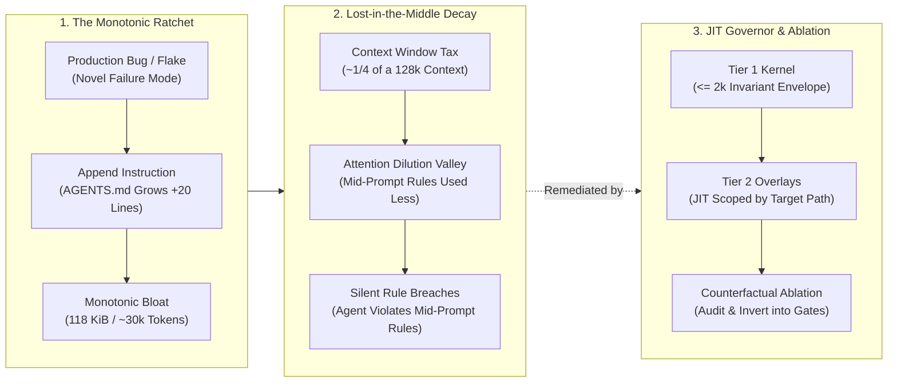
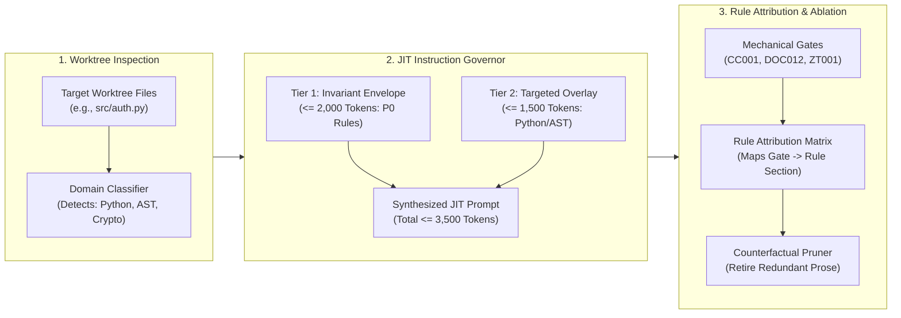

# Observation 31: Instruction Ratchet Bloat and Counterfactual Agent Ablation

> **Project**: Multi-Agent Review Pipelines (`devops-cli` & `vibes`)
> **Environment**: Autonomous agent instruction sets, context window budgets, continuous CI invariant sentinels
> **Classification**: Context Budgeting, Attention Dilution, Instruction Pruning, Counterfactual Ablation
> **Related**: [Observation 08](./08-convention-to-mechanical-enforcement-inversion.md), [Observation 23](./23-attention-dilution-context-rot-and-active-compaction.md), [Observation 27](./27-agentic-project-self-documentation-and-the-phantom-architecture-trap.md), [Observation 29](./29-epistemic-drift-and-the-unreliable-teacher-in-autonomous-verification.md)
> **TLDR**: Resolve prompt bloat and lost-in-the-middle attention decay with two-tier JIT prompt envelopes and an ablation audit of instruction sections.
> **ELI:7b**: Prune giant prompt instruction files by testing which rules actually change agent behavior and deleting rules that don't do anything.

---

## 1. Executive Context & Baseline

A cornerstone principle of disciplined agentic development is **Root-Cause Hardening** (Pillar 5): whenever an agent struggles, hallucinates, or violates a boundary, the root cause must be diagnosed and codified into canonical agent instructions (`AGENTS.md`) to prevent recurrence.

While this principle is vital during early bootstrapping, over prolonged development lifecycles it induces a dangerous cognitive dynamic: **The Instruction Ratchet**.

$$\frac{d(\text{Rules})}{dt} > 0, \quad \text{while} \quad \frac{d(\text{Pruned Rules})}{dt} \approx 0$$

Because adding a rule feels safe and deleting a rule feels risky, instruction files grow monotonically. In this repository, `AGENTS.md` reached 120,786 bytes (118 KiB, about 30,000 tokens at four bytes per token) at commit `fb373aa` on 2026-09-24, before #85 cut it to 43,174 bytes. That weight is an unbudgeted tax on every agent turn: close to a quarter of a 128k context window before a single project file is loaded.

More critically, monolithic instruction growth puts rules in the middle of long prompts, where models use information less well (the **Lost-in-the-Middle** effect; Liu et al., TACL 2024). This repository has no measurement of rule adherence by position.

---

## 2. The Observed Phenomenon

No benchmark of instruction size was run. The effects below are expected costs, stated without measured values:

### 2.1 The 30,000-Token Tax and Linear Latency Drag
- A larger prompt adds prefill work and time-to-first-token (TTFT) on every turn unless the provider caches the prompt prefix.
- The instruction file is sent again on each turn, so its input-token cost grows with the number of turns in a session.

### 2.2 The Attention Dilution Valley & Selective Amnesia
No adherence data by rule position was recorded. The rules at risk are the ones in the middle of a long file: crucial negative constraints such as prohibiting circular symlink traversal, avoiding raw `assert` sprawl in test suites, and adhering to RFC 5737 documentation IP blocks.

### 2.3 The "Inversion Ceiling" Paradox
When rules were converted from conversational prose into deterministic pre-commit gates (such as `sentinel.py` for complexity and `docs_validator.py` for Mermaid syntax):
- The gate blocks a violating commit at the git boundary, whatever the prose says.
- However, the corresponding prose sections in `AGENTS.md` were never removed. The prompt continued instructing the model on rules that automated tooling already enforced deterministically, wasting tokens on redundant cognitive leashing.

---

## 3. The Underlying Failure Mode or Catalyst

The root cause is the **Unabated Instruction Accumulation Dilemma**:

1. **Asymmetric Risk in Rule Pruning**:
   - Adding a rule has an immediate visible justification: *"We had a bug; this rule warns against it."*
   - Deleting a rule introduces fear of regression: *"What if the model forgets this edge case from six months ago?"*
   - Without empirical ablation testing, rules become sacred historical monuments.
2. **Context Window Tragedy of the Commons**:
   - Every domain (eBPF, Rust affine types, CommonMark linters, Kubernetes manifests, GitHub Actions) demands dedicated instructions.
   - Concatenating all domain rules into a single global `AGENTS.md` assumes the agent works on all domains simultaneously. Many sessions touch only one domain (e.g., Python AST refactoring or Markdown documentation); this repository has not measured the share.
3. **Cognitive Saturation & Softmax Competition**:
   - Transformer attention mechanisms distribute attention weights across input tokens via the softmax function.
   - When 30,000 instruction tokens compete with 1,500 code tokens, the average attention weight on any specific line of code or boundary condition falls as roughly $1/N$, which is inverse, not exponential.

---

## 4. Remediation & Architectural Pattern

The pattern below addresses this failure: the **Just-In-Time (JIT) Instruction Governor and Counterfactual Ablation Protocol**:

### Core Invariants:

1. **Two-Tier JIT Decomposition**:
   - **Tier 1 (Universal Invariant Envelope)**: A strictly bounded ($\le 2,000$ tokens) core prompt containing non-negotiable architectural principles (TDD contracts, zero-trust sanitization, complexity caps, and clean solutions). This envelope is loaded into all sessions.
   - **Tier 2 (Domain Overlays)**: Modular rule fragments ($\le 1,500$ tokens each) dynamically hydrated based on target file extensions:
     - `*.py` $\to$ Python AST and pytest tuple consolidation rules.
     - `*.md` $\to$ CommonMark, Mermaid AA contrast, and KaTeX math rules.
     - `*.rs` $\to$ Rust affine type and zero-sized marker invariants.
     - `.github/*` $\to$ GitHub Actions rate limit and isolation policies.
2. **Rule Attribution Mapping**:
   - Every mechanical gate code (`CC001`, `DOC012`, `AIBOM001`, `ROT002`, `EBPF001`) must map to an instruction section. The map is many-to-one, not a bijection: `RuleAttributionMatrix` gives each code in `KNOWN_GATES` the first section that matches it, so several codes can share one section.
   - If an automated gate provides 100% mechanical protection, the corresponding prose in `AGENTS.md` is condensed to a concise one-line invariant reference.
3. **Counterfactual Rule Ablation Testing**:
   - A counterfactual ablation runs the agent with and without a rule section and compares the gate failures. `tools/instruction_governor.py ablate` does not do that: it flags a section as a candidate statically, when the section names a known gate code and exceeds 500 estimated tokens. The sweep below is the protocol for a real ablation; it is not implemented here.
   - Periodic synthetic ablation sweeps execute prompt perturbation benchmarks with individual rule sections removed.
   - If removing a rule yields zero increase in mechanical gate failures across 50 simulated turns, the rule is flagged for automated pruning or conversion to a mechanical oracle.

---

## 5. Verifiable Impact & Key Takeaways

The one measured change is the size cut in #85: `AGENTS.md` went from 120,786 bytes at `fb373aa` to 43,174 bytes at `4c2a94d` (`git show <sha>:AGENTS.md | wc -c`). No TTFT, adherence, token-per-PR or first-turn pass rate was measured before or after it.

### Summary Maxim:
> *An instruction file that only grows is an instruction file that eventually ceases to be read. True discipline lies not in hoarding every historical warning, but in inverting prose into mechanical gates and delivering instructions just in time.*

