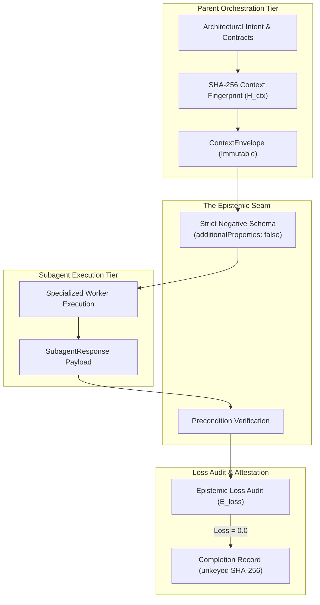

# Observation 33: Typed Epistemic Seams and Lossless Subagent Handshakes

> **Project**: Hierarchical Multi-Agent Review & Orchestration Systems
> **Environment**: Multi-agent delegation seams, subagent offloading, hashed invariant envelopes
> **Classification**: Multi-Agent Epistemics, Context Budgets, Negative Schemas, Attestation
> **Related**: [Observation 21](./21-hierarchical-subagent-slot-offloading-and-epistemic-loss.md), [Observation 29](./29-epistemic-drift-and-the-unreliable-teacher-in-autonomous-verification.md), [Observation 32](./32-dual-first-class-consumers-and-bi-directional-agentic-feedback-loops.md)
> **TLDR**: Detect delegation drift with content-addressed invariant envelopes and negative schema checks across hierarchical subagent boundaries.
> **ELI:7b**: Package subagent tasks with a fingerprint and strict data types, so the parent can reject a reply that drops a rule or adds an unknown parameter.

---

## 1. Executive Context & Baseline

As autonomous software development transitions from monolithic single-agent loops to hierarchical multi-agent swarms ("Big decides, small types, big checks"), tasks are subdivided across specialized subagents:
1. **Parent Reasoning Agent**: Orchestrates overall architectural intent, establishes test contracts, and manages the SDLC state.
2. **Specialized Worker Subagents**: Implement leaf functions, optimize specific algorithms, or refactor AST nodes in parallel.

In theory, offloading work to lightweight subagents dramatically reduces token expenditures. In practice, however, delegation introduces a critical vulnerability: **The Epistemic Seam Trap**.

When context is serialized into free-form natural language across the delegation boundary, nuances in invariants, precondition assumptions, and schema bounds degrade. Without mechanical contract verification, subagents return work that appears plausible but violates parent-level architectural invariants.

---

## 2. The Observed Phenomenon

Three breakdown patterns can occur at the delegation seam. They are failure modes, not measured rates:

### 2.1 The Dropped Precondition Hazard
A parent agent requires that all edits preserve structural tuple assertions and maintain $M \le 4$. When delegated via natural language prompts, the subagent focuses solely on the functional deliverable, silently dropping the structural assertion constraint.

### 2.2 Hallucinated Parameter Creep
Subagents operating under partial prompt visibility frequently invent additional tool arguments or alter function signatures. Because traditional JSON Schema allows untyped properties by default, the parent receives uncontracted keys that trigger runtime validation failures downstream.

### 2.3 Epistemic Drift Across Iterations
When a subagent makes multiple self-correction passes, its local working memory drifts from the original task specification. Each retry step dilutes the original intent, resulting in code that diverges further from the required solution.

---

## 3. The Architectural Solution

To eliminate delegation boundary degradation, we engineered the **Typed Epistemic Seam & Context Handshake Protocol** ([`examples/epistemic-context-handshake/`](../../examples/epistemic-context-handshake/)).

### 3.1 Content-Addressed Invariant Envelopes
Every delegation payload is bundled into a frozen `ContextEnvelope` dataclass carrying a deterministic SHA-256 hash ($H_{\text{ctx}}$) over:
- Required symbol definitions
- Explicit preconditions (e.g. test suites passing, clean working tree)
- Allowlisted tool parameters

The hash is unkeyed. It detects an envelope whose fields no longer match its own hash. Anyone who edits the fields can also recompute the hash, so it is not a signature or an attestation. Proof of origin needs a keyed signature, for example HMAC or Ed25519.

### 3.2 Negative Schema Boundary Enforcement
All parameters exchanged across the boundary enforce strict `additionalProperties: false` semantics. Any uncontracted argument immediately fails the handshake with an actionable diagnostic.

### 3.3 Epistemic Loss Quantification ($E_{\text{loss}}$)
The protocol quantifies epistemic loss as a normalized scalar:

$$E_{\text{loss}} = \frac{N_{\text{dropped\_preconditions}} + N_{\text{schema\_violations}}}{N_{\text{total\_constraints}}}$$

If $E_{\text{loss}} > 0$, the audit marks the deliverable invalid and lists each violation. The example does not route the deliverable back to the subagent; the caller must do that.

---

## 4. What the Reference Example Verifies

No multi-agent deployment of this protocol was measured. The example's tests (`examples/epistemic-context-handshake/test_context_handshake.py`) show what each check does on fixed inputs:
- **Undeclared Arguments**: An argument that is not in `allowed_parameters` makes the audit fail (`test_check_negative_schema_bounds`).
- **Dropped Preconditions**: A precondition missing from the reply makes the audit fail (`test_audit_epistemic_loss_dropped_preconditions`). The subagent reports `satisfied_preconditions` itself, so the check confirms that the subagent claims each precondition, not that the precondition holds.
- **Speed**: No measurement of convergence speed exists.

---

## 5. Lessons for Agentic Engineering

1. **Natural Language Prompts Are Not Contracts**: Never delegate critical subagent tasks with free-form prose. Always wrap handoffs in typed, content-addressed envelopes.
2. **Negative Schemas Reject Hallucinated Arguments**: Tool definitions must explicitly forbid undefined arguments (`additionalProperties: false`).
3. **Check Every Handoff Against Its Envelope**: Verify that the reply names the envelope ID before you accept the deliverable. Use a keyed signature if the parties must prove who made the hash.

