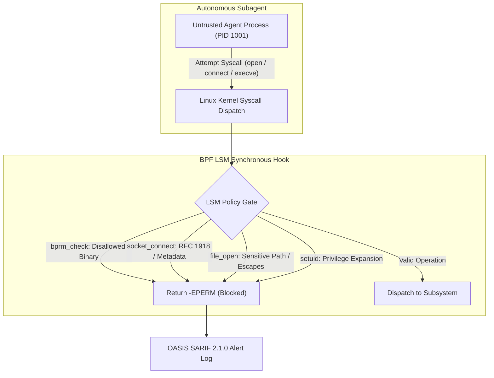

# Observation 34: eBPF LSM Kernel Gates and Dynamic Containment Fuzzing

> **Project**: Kernel-Enforced Agent Containment & Sandbox Isolation
> **Environment**: Unprivileged subagent sandboxes, Linux Security Module (BPF LSM) hook design, Python policy simulation
> **Classification**: Kernel Security, eBPF, Invariant Gating, Adversarial Robustness
> **Related**: [Observation 24](./24-ebpf-process-tracing-for-agent-sandbox-introspection.md), [Observation 30](./30-kinetic-falsification-and-the-ephemeral-exploit-harness.md), [Pattern: Kernel-Enforced LSM Sandbox Containment](../../patterns/kernel-enforced-lsm-sandbox-containment.md)
> **TLDR**: In-kernel BPF LSM hooks can deny an agent's syscall synchronously with -EPERM, before it takes effect; the reference example simulates those policy decisions in Python.
> **ELI:7b**: A small program inside the Linux kernel can stop a risky command before it runs. The example here only acts out those decisions in Python.

---

## 1. Executive Context & Baseline

When autonomous AI agents execute terminal commands, run build scripts, or orchestrate subprocesses, containment is traditionally enforced at user-space boundaries:
1. **Container Namespaces & Cgroups**: Restrict memory, CPU, and PID limits.
2. **User-Space Hook Sentinels**: Inspect tool inputs and command strings prior to dispatch.
3. **Passive Kernel Tracing (Auditd / Kprobes)**: Asynchronously log syscall events to a ring buffer for post-hoc analysis.

While user-space sentinels catch predictable errors, they fail against adversarial payloads: subagents can invoke unquoted shell expansions, spawn unmonitored subshells, or perform symlink directory escapes that evade user-space argument parsers.

Furthermore, **passive audit logs are inherently reactive**. In a multi-tenant or automated environment, an asynchronous alert that fires 20ms *after* a socket connection has opened or a file has been read is already too late.

---

## 2. The Observed Breakdown Modes

Three failure modes follow from how user-space and asynchronous enforcement work. No audit data backs them:

### 2.1 The Asynchronous Detection Race Window
In tracepoint-based or auditd architectures, security daemons read events from a kernel perf buffer asynchronously. The delay between the syscall and the user-space alarm depends on buffer polling and system load. During this window, an untrusted script can transmit credentials over an open socket or modify files before the tracer can issue a `SIGKILL`.

### 2.2 Path Normalization & Symlink Obfuscation
User-space scanners that match regexes against `/etc/shadow` or `~/.ssh` miss paths that reach the same file by another route:
- Relative traversal: `/workspace/..//..//etc/shadow` resolves to `/etc/shadow`.
- Symbolic links: `/workspace/notes` can be a link to `/etc/shadow`.

Other strings only confuse a scanner and reach nothing: `...` is an ordinary file name on Linux, and the kernel reads a path argument only up to its first NUL byte.

Because user-space inspectors evaluate raw string arguments rather than the resolved file, such accesses can pass undetected.

### 2.3 Binary Execution Smuggling
Untrusted workloads constrained to "safe" developer tools can invoke unauthorized utilities (`nc`, `socat`, `telnet`) via disguised symlinks or shell scripts, bypassing static wrapper allowlists.

---

## 3. The Architectural Solution

The design pairs **Synchronous In-Kernel LSM Policy Enforcement** with **mutation tests of the policy**. The reference example ([`examples/ebpf-lsm-kernel-gate/`](../../examples/ebpf-lsm-kernel-gate/)) is a Python simulation of that design. It loads no BPF program and touches no kernel interface: `evaluate_event()` in `lsm_gate.py` applies the policy to `LSMEvent` objects in user space. It ships no BPF C. For kernel enforcement, `generate_tetragon_policy()` emits a Cilium Tetragon `TracingPolicy` whose kprobe selectors send `Sigkill` for blocked binaries, absolute blocked paths and egress. No test loads that policy into a kernel.

### 3.1 Synchronous Pre-Execution Denial (`-EPERM`)
Unlike passive kprobes, BPF LSM hooks (`bpf_lsm_file_open`, `bpf_lsm_bprm_check_security`, `bpf_lsm_socket_connect`) execute *synchronously* within the kernel's authorization path. A BPF LSM program that implements the policy returns `-EPERM` for a violating event, and the syscall fails: the file does not open, the socket does not connect, or `execve` does not start the new program. (`bprm_check_security` runs inside `execve`, after the fork.) In the example, this decision is a Python return value.

### 3.2 Fixed Mutation List (Syzkaller-Inspired)
To test the policy against path and address tricks, `run_fuzz_campaign()` evaluates 31 events: 16 spellings of the policy's absolute blocked paths (plain, `/./`, `//` and `..`), 5 fixed evasion paths, 6 socket targets, 3 binaries and 1 `setuid`. This is not syzkaller. It does not generate syscalls from descriptions, use coverage feedback, mutate inputs or run a kernel, and its `seed` argument is unused. A fixed list cannot show that no bypass exists.
- Lists path variations (`/./`, `//`, `..//`, `.../`, NUL bytes).
- Lists private RFC 1918/4193 addresses and the link-local metadata endpoint (`169.254.169.254`).
- Asserts **Monotonic Containment**: at most one of the 31 events may be allowed. On the default policy, 30 are blocked and the loopback connect is allowed (`python examples/ebpf-lsm-kernel-gate/lsm_gate.py fuzz`).

The simulated `file_open` check normalizes `.`, `..` and repeated slashes, then matches path strings (prefix or substring). It does not resolve symbolic links, so it keeps the symbolic-link weakness that Section 2.2 describes.

---

## 4. Comparison of Mechanisms

No benchmark was run. The comparison below follows from where each mechanism runs:

| Property | Passive Audit / Kprobe Tracing to User Space | BPF LSM Program in the Kernel |
|---|---|---|
| **Interception Point** | After the event, read from a ring buffer | Inside the kernel's authorization check |
| **Blocking** | A user-space daemon must react (for example with `SIGKILL`) | The hook returns `-EPERM` and the syscall fails |
| **Path Evaluation** | Raw string arguments | Kernel objects (`struct file`, inode) after path resolution |
| **Data Leakage Under Attack** | Data can leave before the daemon reacts | The denied operation does not start |

---

## 5. Architectural Takeaways

1. **Pre-Execution Denial Over Post-Mortem Logging**: In agentic autonomy, reactive logging is equivalent to failure. Security constraints must run in-line with execution, returning immediate error codes before state modification.
2. **Canonical VFS Resolution Over String Matching**: Never evaluate filesystem paths using raw text prefixes. Inode-level and canonical VFS evaluation at the LSM layer stops traversal escapes by construction.
3. **Mutation Tests as a Quality Gate**: Static rules are brittle. Run a list of known escape forms against the policy in CI. For coverage-guided kernel fuzzing, use syzkaller itself.

