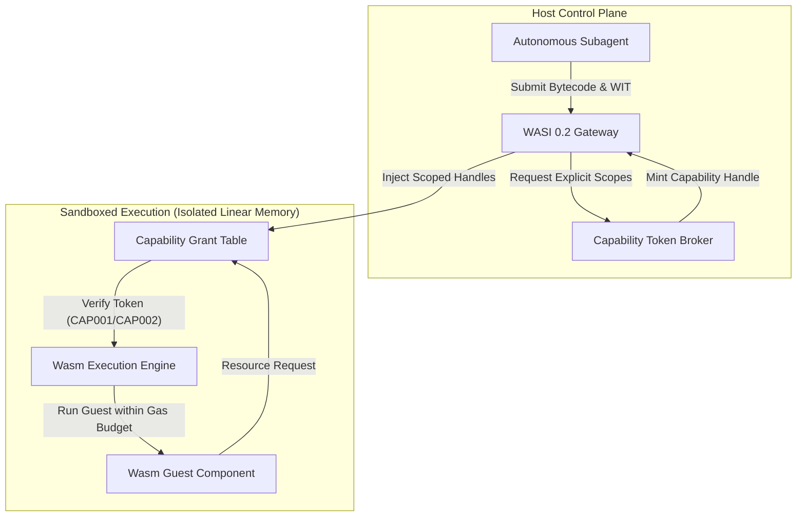

# Observation 36: WASI Component Models and Capability-Based Tool Sandboxing

> **Project**: Autonomous Agent Runtime Isolation & Capability Sandboxing  
> **Environment**: WASI 0.2 Component Model design, Python capability simulation, POSIX ambient authority  
> **Classification**: Systems Engineering, Sandboxing, Security Architecture, WebAssembly  
> **Related**: [Observation 07](./07-agentic-ide-protocols-and-lsp-mcp-convergence.md), [Observation 34](./34-ebpf-lsm-kernel-gates-and-dynamic-containment-fuzzing.md), [Pattern: Capability-Based Wasm Sandboxing](../../patterns/capability-based-wasm-sandboxing.md)
> **TLDR**: WASI 0.2 runtimes give a guest no ambient authority and can meter its fuel; the reference example simulates capability checks and an instruction budget in Python and runs no WebAssembly.
> **ELI:7b**: Run AI plugins in WebAssembly modules where each tool can reach only the files you grant it, with an instruction budget. The example here checks those rules in Python and does not run WebAssembly.

---

## 1. Executive Context & Baseline

Autonomous software engineering agents increasingly generate and execute ephemeral helper utilities, format converters, and data scrapers during complex multi-step tasks. In traditional architectures, these tools run either:
1. **Directly on the Host via Ambient Processes** (`python -c`, `bash`, `subprocess.Popen`): The spawned tool inherits the ambient authority of the parent agent, with full access to user dotfiles, SSH keys, cloud tokens, and unrestricted network sockets.
2. **Inside Ephemeral Container Sandboxes** (`docker run`, cgroups v2): While secure, container cold-starts add start-up latency and memory to every invocation, creating a massive latency tax in iterative verification loops.

---

## 2. The Breakdown of Ambient Authority & Container Latency

Two operational failure modes apply. No benchmark data backs them:

### 2.1 The Ambient Authority Vulnerability (CWE-250 / CWE-200)
When an agent is allowed to execute arbitrary scripts under ambient authority, minor prompt drift or hallucinated imports can lead to catastrophic data exfiltration:
- A python helper reading `os.environ` accesses parent API tokens and AWS credentials.
- A script invoking `open("/etc/hosts")` or traversal paths scans private network topologies.
- Ambient network sockets allow unauthorized outbound beacons to arbitrary endpoints.

### 2.2 Container Startup Latency Penalty
In iterative test-driven generation (e.g. generate-and-test loops that try 50 candidate regexes or data transformations), container startup can dominate runtime: namespaces, network setup and daemon calls can take far longer than a short task's computation. This repository has no measurement of that ratio.

---

## 3. The Architectural Solution: WASI 0.2 Object Capabilities

The design routes tools through a **WASI 0.2 Capability-Based Sandbox Gateway**. The reference example ([`examples/wasm-capability-sandbox/`](../../examples/wasm-capability-sandbox/)) is a Python simulation of it. It checks the Wasm header magic and section IDs, parses WIT text, and checks requested paths and hosts against capability handles. It does not load or run any WebAssembly, and it has no Wasm runtime dependency.

### 3.1 Object-Capability Discipline
In WASI 0.2, a component begins execution with **zero capabilities**. There is no ambient `open()`, `connect()`, or `getenv()`. The host runtime explicitly injects preopened directory handles (`wasi:filesystem/preopens`) and specific monotonic clocks (`wasi:clocks/monotonic-clock`). A real runtime makes handles unforgeable: they are resource handles that guest code cannot fabricate. The example only simulates this. `check_filesystem_access()` and `check_network_dial()` return `CAP001` or `CAP002` for an ungranted path or host. `create_capability()` gives each handle a random ID and records the handle in a registry in the module. The checks accept a handle only if the registry holds the same handle, so a hand-built handle gets `CAP001` or `CAP002`. Python code in the same process can still read or change the registry, so the example shows the check and not the isolation.

### 3.2 Deterministic Gas Budgeting & Halting Defense (CWE-400)
Fuel (gas) metering is a runtime feature, not part of WASI. For example, Wasmtime's `Config::consume_fuel` decrements fuel as the guest runs and traps when it reaches zero, which bounds execution without asynchronous OS signals. The example simulates this: `run_metered_workload()` steps through a Python list of `(op, cost)` tuples and returns `CAP003` (`GAS_EXHAUSTED`) when the budget runs out.

---

## 4. Comparison Matrix

No benchmark was run, so the matrix has no latency or memory figures. It compares the isolation properties of each mechanism:

| Property | Ambient Host Process | Rootless Container (Docker) | WASI 0.2 Component |
|---|---|---|---|
| **Ambient Authority** | Unrestricted (CWE-250) | Confined | **None: only granted handles** |
| **Halting Protection** | OS SIGKILL / Timeout | cgroup CPU quota | **Fuel metering or epoch interruption (runtime feature)** |
| **Egress Containment** | Host Network | Bridge / `--network none` | **Only granted `wasi:sockets` handles** |

---

## 5. Strategic Recommendations for Autonomous Swarms

1. **Adopt WASI 0.2 for High-Frequency Ephemeral Tools**: Reserve container sandboxes for long-running compile tasks; route all data parsing, regex evaluation, and script generation through capability-gated Wasm components.
2. **Enforce WIT Interface Parity**: Validate guest imports against declared capabilities before instantiation (`CAP005`), preventing unhandled runtime traps.
3. **Bind Gas Limits to Task Priority**: Assign bounded gas budgets calibrated to expected algorithmic complexity, ensuring runaway code fails fast.
