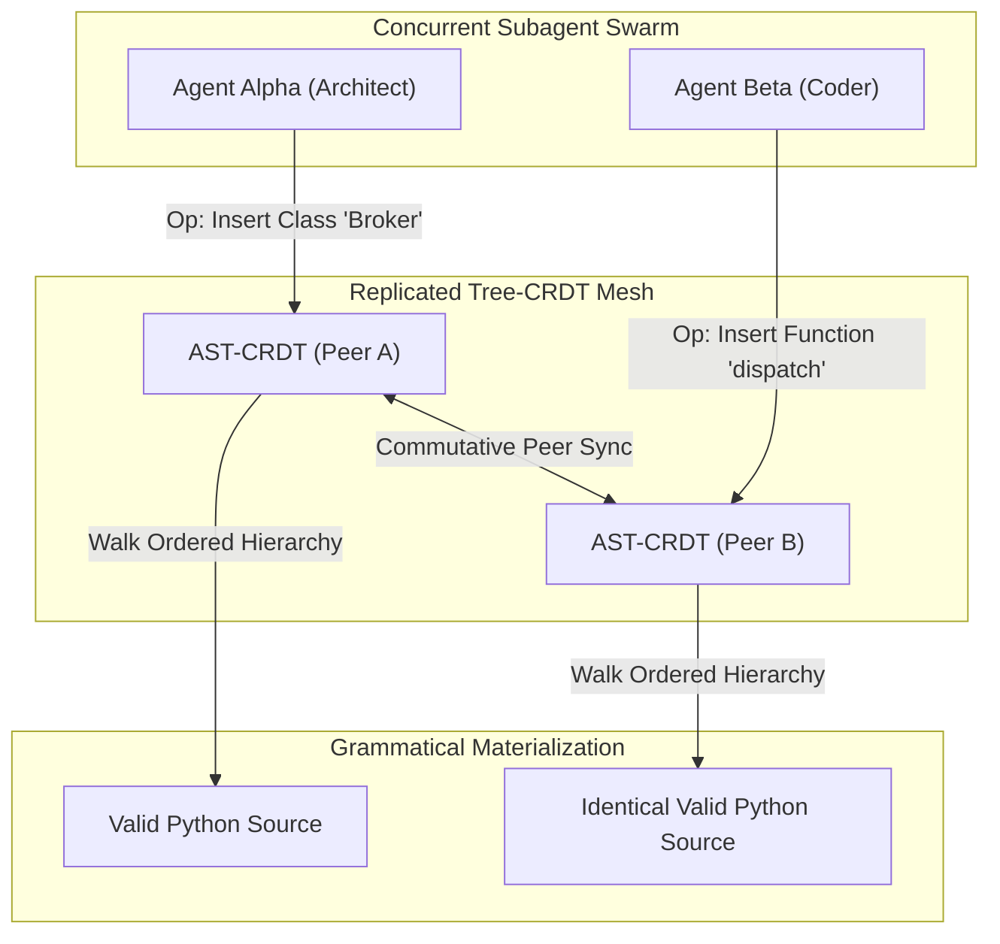

# Observation 37: Real-Time AST-CRDTs and Concurrent Multi-Agent Swarms

> **Project**: Multi-Agent Concurrency & Conflict-Free AST Synchronization  
> **Environment**: Distributed AI coding swarms, real-time collaborative editing, AST Tree-CRDTs  
> **Classification**: Distributed Systems, CRDTs, Multi-Agent Concurrency, AST Engineering  
> **Related**: [Observation 06](./06-multi-agent-concurrency-shared-workspace-hazards-and-swarm-coordination.md), [Observation 35](./35-3-way-ast-semantic-reconciliation-and-worktree-collision-arbitration.md), [Pattern: AST-CRDTs for Real-Time Agent Collaboration](../../patterns/ast-crdts-for-real-time-agent-collaboration.md)
> **TLDR**: Avoid character-level interleaving under concurrent multi-agent editing by replicating AST nodes instead of characters; the reference example converges for inserts and deletes, but not for concurrent moves.
> **ELI:7b**: Allow multiple AI coders to edit code in real time like Google Docs, using syntax tree nodes instead of raw characters. The example tracks only the names of imports, functions and classes.

---

## 1. Executive Context & Baseline

When scaling autonomous AI coding swarms beyond serial task execution, multiple specialized subagents (e.g. an Architectural Planner structuring types, an Implementation Worker authoring function bodies, and a Verification Agent adding unit tests) must collaborate on the same module simultaneously.

While git worktrees ([`worktree-swarm-arbiter`](../../examples/worktree-swarm-arbiter/)) and 3-way AST merge drivers ([`ast-semantic-reconciler`](../../examples/ast-semantic-reconciler/)) solve branch-level integration at commit time, real-time collaboration requires **in-memory streaming synchronization** without waiting for full git checkout, commit, and push cycles.

---

## 2. The Breakdown of Textual CRDTs Under Code Synthesis

Standard distributed collaborative editing relies on text CRDTs (RGA, LSEQ, and the text types of Yjs and Automerge), which replicate character sequences. When applied to structured code authored by concurrent LLMs, these failure modes can occur:

### 2.1 The Token Interleaving Trap
Sequence CRDTs operate on flat 1D arrays of characters. Some of them (Logoot, LSEQ) can interleave two concurrent insertions character by character; RGA does not (Kleppmann et al., "Interleaving anomalies in collaborative text editors", PaPoC 2019). When Agent A introduces a type annotation (`def parse(x: int)`) and Agent B concurrently introduces a default parameter (`def parse(x=10)`), an interleaving CRDT can produce:
```text
def parse(x: =i1n0t):
```
Without interleaving, the two runs can still merge as `def parse(x=10: int)`, which is not valid Python. Text CRDTs lack symbol awareness, so they can corrupt lexemes and halt downstream compiler pipelines.

### 2.2 Scope and Indentation Fractures
In indentation-sensitive grammars (Python, YAML), concurrent character insertions near block boundaries shift the relative indentation level of subsequent lines. An insert by Agent A can inadvertently capture Agent B's unrelated statements inside an `if` block or class definition.

### 2.3 No Measured Failure Rate
This repository has no harness that simulates collaborative editing sessions, so it has no measured syntax invalidation rate for text CRDTs.

---

## 3. The Architectural Solution: AST Tree-CRDTs

To remove character-level breakage, we designed the **Real-Time AST Tree-CRDT** ([`examples/ast-crdt-collaborative-editor/`](../../examples/ast-crdt-collaborative-editor/)). The example models only top-level imports, functions and classes. `materialize_to_source()` renders each function and class with an empty `pass` body, and it does not model parameters, annotations or bodies, so the conflict in 2.1 cannot be expressed in it.



### 3.1 First-Class Replicated AST Nodes
Rather than synchronizing characters, the Tree-CRDT synchronizes typed AST nodes:
- Each node holds a globally unique Lamport identifier: `agent_id:lamport:counter`.
- Sibling nodes within a parent are ordered by a position string `pos`, compared as text, with the node ID as tie-breaker. The order does not depend on arrival sequence, but it is lexicographic, not numeric: `"10"` sorts before `"9"`. A fractional-indexing scheme must generate keys that sort correctly as text.
- Insert and delete operations commute: an insert is ignored if its node ID exists, and a delete sets a tombstone. Move operations do not commute: `_apply_move()` applies moves in arrival order and ignores their Lamport timestamps.

### 3.2 Cycle Avoidance Arbitration (`CRDT001`)
In tree structures, concurrent move operations can induce cycles (e.g. moving node $A$ into child $B$ while concurrently moving $B$ into $A$). The example checks the ancestry chain and rejects a move that would make a node its own ancestor, so each replica stays a tree. It does not use the Lamport timestamps to choose a winner. In that two-move case, peer A keeps its own move and rejects B's, and peer B does the reverse, so the replicas diverge (checked with `apply_operation` and `sync_peers` on 2026-11-19). A move operation that converges needs an algorithm such as Kleppmann et al., "A highly-available move operation for replicated trees" (IEEE TPDS, 2022), which orders moves by timestamp and undoes and redoes them.

---

## 4. Comparison Matrix

No collaborative editing scenarios were run. The matrix compares properties of the two approaches:

| Property | Sequence CRDT (Text) | AST Tree-CRDT Example (`ast-crdt`) |
|---|---|---|
| **Unit of Replication** | Characters | Import, function and class nodes |
| **Character Interleaving** | Possible in Logoot and LSEQ | Not possible: no characters are replicated |
| **Materialized Syntax** | Can be invalid | Fixed templates (`def name(): pass`); names are not validated |
| **Concurrent Moves** | Not applicable | Replicas can diverge |

---

## 5. Strategic Recommendations for Autonomous Swarms

1. **Use AST-CRDTs for In-Memory Multi-Agent Pairing**: When multiple subagents work on a single file simultaneously (e.g. paired programming or real-time review), use an AST-CRDT state machine rather than text buffers.
2. **Materialize at Invariant Verification Boundaries**: Trigger Python `ast.parse()` validation only when an agent needs to execute tests or invoke linters, allowing intermediate concurrent edits to commute safely.
3. **Decouple In-Memory CRDTs from Git Persistence**: Maintain the fast AST-CRDT in memory during collaborative sessions, and commit the materialized AST to git only when all agents reach convergence.
