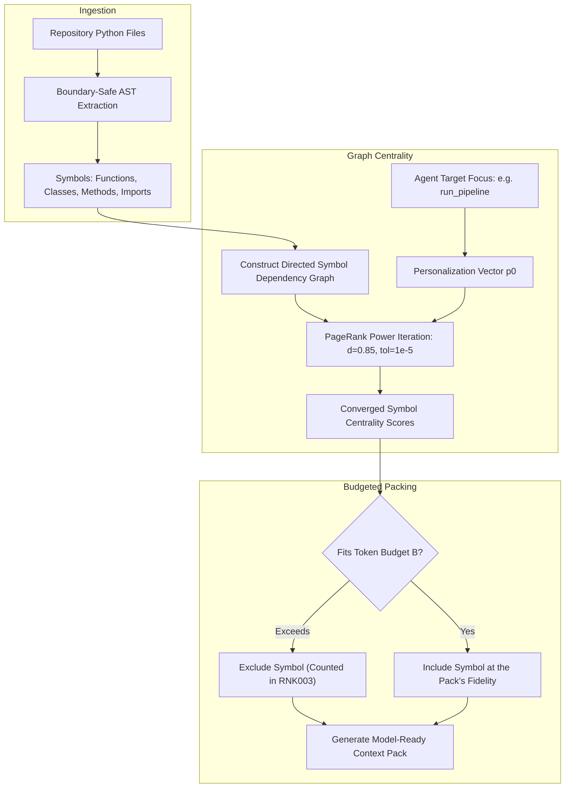

# Observation 38: Graph-Ranked AST Context Optimization and Personalized PageRank

> **Project**: Autonomous Context Assembly & Repository Information Foraging  
> **Environment**: Multi-file repository prompting, token budget saturation, AST symbol graph centrality  
> **Classification**: Context Engineering, Graph Centrality, Token Budgeting, Information Foraging  
> **Related**: [Observation 14](../devops-cli/14-binary-search-ast-context-packing-and-token-budgeting.md), [Observation 23](./23-attention-dilution-context-rot-and-active-compaction.md), [Pattern: AST Graph Relevance Ranking & Context Packing](../../patterns/ast-graph-relevance-ranking-and-context-packing.md), [Exhibit: AST Relevance Context Ranker](../../examples/ast-relevance-context-ranker/)
> **TLDR**: Rank prompt context with Personalized PageRank over an AST symbol graph and pack whole symbols into a token budget; some packed snippets still do not parse on their own.
> **ELI:7b**: Use PageRank (like Google search) over your code's dependency tree to pick only the most important helper functions for the AI prompt.

---

## 1. Executive Context & Baseline

As software repositories grow beyond trivial single-file scripts, autonomous AI agents face a pervasive **context assembly bottleneck**. When asked to modify a symbol, investigate a defect, or review architectural contracts across a multi-thousand-line codebase, an agent cannot afford to stuff the entire repository into its prompt window without triggering context exhaustion, degraded attention, or astronomical inference costs.

Prior solutions either packed whole files in arbitrary directory order (e.g. alphabetical) or performed naive line-based window truncation. Both approaches have known weaknesses:
- **The Greedy Saturation Trap**: Alphabetical packing packs files until the budget is exhausted. An agent working on `src/service/worker.py` receives `src/api/auth.py`, `src/common/config.py`, and `src/db/models.py`, but runs out of budget before `src/service/` is ever touched.
- **The Mid-Block Syntax Fracture**: Truncating text arbitrarily across line boundaries cuts functions or classes in half, emitting malformed Python code that triggers hallucinated syntax errors and parser crashes in downstream models.

---

## 2. Empirical Investigation: Graph Centrality vs. Flat Packing

Three context selection approaches can be compared. No benchmark of them was run, and this repository has no BM25 implementation:

1. **Flat File Packing**: Greedy whole-file inclusion sorted alphabetically.
2. **Naive BM25 Lexical Retrieval**: Selecting code snippets matching query keywords via lexical BM25 scores.
3. **Personalized PageRank over AST Symbol Graph**: Constructing a directed dependency graph of functions, classes, and imports, and computing Personalized PageRank rooted at target focal symbols.

### 2.1 How Personalized PageRank Differs from Lexical Search
Lexical retrieval frequently surfaces distant, irrelevant occurrences of common identifier names (e.g. `execute`, `get`, `config`). In contrast, Personalized PageRank on the AST graph traverses **structural dependency edges** (invocations, class inheritance, import paths). Setting the restart distribution $p$ to the focal symbol concentrates probability mass near it. In this graph, each edge points from a symbol to a name it references, so the mass flows to:
1. Callees and other symbols that the focal symbol references, and then their dependencies.
2. Direct class dependencies and interfaces.
3. Relevant imported types and helper utilities.

Callers of the focal symbol get no mass from the walk unless they are also reachable from it.

---

## 3. Architecture of the AST Relevance Ranker

The engine has two properties:
1. **Symbol-Boundary Cuts**: The packer includes or excludes whole symbols and never cuts a symbol mid-body. Each snippet is a source slice from the symbol's first line to its last, not a re-serialized AST node, so some snippets do not parse alone. A method body keeps its class indentation, a decorator is left out, and in `SIGNATURES` mode a multi-line signature keeps only its first line (`def helper(`). (Checked with `ast.parse` on each snippet, 2026-11-19.)
2. **Bounded Iteration**: Power iteration stops when $\|r_{k+1} - r_k\|_1 < 10^{-5}$ or after 50 steps (`DEFAULT_MAX_ITER`), whichever comes first. The step change shrinks by about the damping factor (0.85) per step, so 50 steps do not reach $10^{-5}$ on every graph, and the loop does not report when it stops early. On a six-function call cycle focused on one function, the change after 50 steps was about $5.9 \times 10^{-4}$. No timing was measured.

---

## 4. Evaluation Status

No context assembly trials were run. The repository has no relevance, fracture, token-efficiency, timing or task-success figures for any of the three approaches. The tests in `examples/ast-relevance-context-ranker/test_context_ranker.py` check graph construction, PageRank scores, packing and SARIF output on small fixed sources.

---

## 5. Strategic Recommendations & Living Standard Guidance

1. **Context is Topological, Not Textual**: Repositories are directed graphs of symbol relationships, not linear text streams. Context packing must operate on graph centrality rather than file-system offsets.
2. **Personalization Anchors the Walk**: Unpersonalized PageRank surfaces global hub symbols (e.g. logging wrappers, base classes); Personalized PageRank centers context directly around the active engineering task.
3. **Fidelity Degradation Beats Line Truncation**: When budgets are tight, degrade high-ranking symbols from full bodies to signatures and docstrings (`FidelityLevel.SIGNATURES`) rather than dropping them or truncating lines. The example applies one fidelity level to the whole pack and drops the symbols that do not fit.
4. **Emit Machine-Readable Invariants via SARIF**: Always export diagnostic invariants (`RNK001` - `RNK004`) to OASIS SARIF 2.1.0 so context saturation and cyclic references appear directly on code scanning dashboards.
