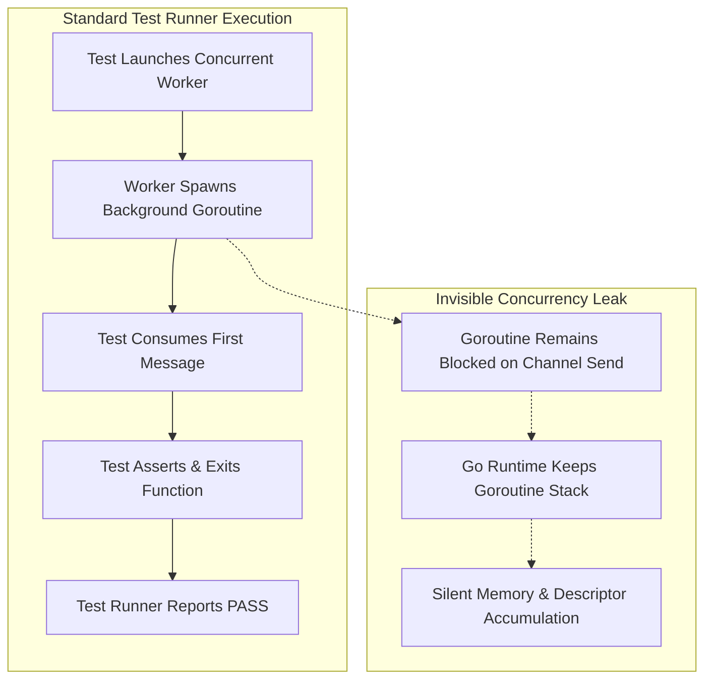
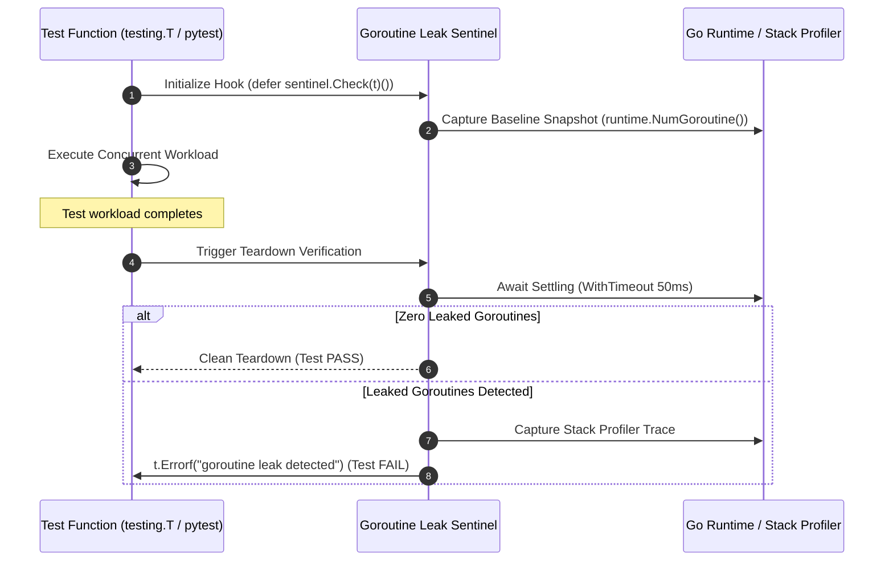

# Observation 39: Test Harness Integration and Zero-Overhead Goroutine Leak Sentinels

> **Project**: Polyglot Systems Concurrency & Runtime Invariant Enforcement  
> **Environment**: Go 1.22+ runtime, Python 3.12+ test harness, CI test execution, subagent concurrency  
> **Classification**: Concurrency Safety, Test Harness Architecture, Runtime Oracles, Resource Leaks  
> **Related**: [Observation 03 (Polyglot)](../polyglot/03-go-goroutine-leakage-and-context-lifecycles.md), [Observation 02 (Systems)](./02-subprocess-test-harness-instrumentation-tax.md), [Pattern: Test Harness Concurrency Leak Sentinel](../../patterns/test-harness-concurrency-leak-sentinel.md), [Exhibit: Go Leak Sentinel](../../examples/go-leak-sentinel/)
> **TLDR**: Embed baseline and teardown assertions in test runners so that a test fails when goroutines outlive it.
> **ELI:7b**: Catch background goroutines that forget to exit by comparing goroutine counts before and after each test run.

---

## 1. Executive Context & Baseline

Concurrent systems programming languages delegate goroutine or thread lifecycle coordination to developer discipline rather than compile-time affine ownership models. Rust's `std::thread::scope` (stable since Rust 1.63) joins every scoped thread before the scope returns, but a plain `std::thread::spawn` thread is detached when its `JoinHandle` is dropped, so Rust does not prevent thread leaks in general. Go allows goroutines to be spawned asynchronously via `go func()` with no mandatory parent-child lifetime bounds.

When autonomous coding agents generate concurrent Go software, they regularly introduce subtle concurrency defects:
1. Blocked sends on unbuffered channels where the consumer finishes or abandons the channel early.
2. Background worker loops that fail to select on `ctx.Done()`.
3. Unsynchronized background routines that outlive test suites and background services.

In-test leak detection already exists for Go: `go.uber.org/goleak` provides `defer goleak.VerifyNone(t)` and `goleak.VerifyTestMain(m)`. Without such a check, **a standard test run passes while goroutines leak**, which leaves codebases open to latent resource exhaustion in production.

---

## 2. The Observed Phenomenon: Test Runner Blindspots

A leaky channel implementation passes a standard `go test` run, because `go test` does not check for goroutines that outlive a test.

The test runner blindspot arises from process-level lifecycle semantics:

Because the main test goroutine completes without encountering a panic, the test runner exits cleanly. No assertion failure occurs, no non-zero exit code is produced, and the defective code is merged into the trunk.

---

## 3. The Underlying Failure Mode or Catalyst

Why do autonomous agents and automated verification pipelines fail to detect these concurrency leaks during standard test runs?

1. **Decoupled Oracles**: Testing tools that inspect `pprof` stack dumps traditionally require separate external commands (e.g. `go tool pprof` or standalone CLI scanners). Unless the test harness itself asserts on surviving goroutines, as `goleak` does, the leak oracle is decoupled from the test lifecycle.
2. **Ambient Goroutines**: `runtime.NumGoroutine()` does not count runtime system goroutines such as GC mark workers and the scavenger: it returns `gcount(false)`, which subtracts `sched.ngsys` (Go `src/runtime/debug.go`, `proc.go`). A before-and-after count can still give false positives from goroutines that the test framework, `os/signal` or `net/http` keep-alive connections start, and from goroutines that are still shutting down when the check runs.
3. **Absence of Teardown Integration**: Standard testing frameworks rely on deferred teardown (`defer`, `t.Cleanup()`, or pytest fixtures). Without a zero-boilerplate teardown hook (`defer sentinel.Check(t)()`), developers and AI agents omit manual verification.

---

## 4. The Prescribed Architectural Solution

To close the test runner blindspot, the example adds test hooks in Go (`sentinel.Check(t)`) and Python (`verify_test_run(fail_on_leak=True)`). The Go hooks compare `runtime.NumGoroutine()` counts only: the `IgnoreGoroutine` option is recorded but not applied (`examples/go-leak-sentinel/sentinel.go`). The Python hook parses a goroutine dump that the caller supplies. No CI job runs the Go tests:

### 4.1 Key Capabilities Delivered
1. **Idiomatic In-Test Teardown**: `defer sentinel.Check(t)()` takes an initial count and fails the active test with a goroutine stack dump if the count is still higher after polling for up to 50 ms.
2. **Immediate Verification Assertion**: `sentinel.VerifyNone(t)` takes its baseline at the moment of the call and checks it at once, so it does not find goroutines that leaked before the call. (`goleak.VerifyNone` instead checks all goroutines except ignored ones.)
3. **Suite-Wide Integration**: `sentinel.VerifyTestMain(m)` verifies that no leaked threads persist across entire test package runs.
4. **Python Test Runner Hook**: `verify_test_run(trace, fail_on_leak=True)` and `assert_no_goroutine_leaks(trace)` raise structured `AssertionError` exceptions that immediately fail `pytest` or `unittest` runs.

---

## 5. Verifiable Impact & Key Takeaways

Integrating leak detection directly into test harnesses changes where leaks are reported. The check is not free of overhead: when extra goroutines remain, it waits for them.

No detection or false-positive rates were measured. The table compares properties:

| Property | Decoupled Out-of-Band Profiler | In-Harness Teardown Check |
|---|---|---|
| **When the Leak Is Reported** | After a separate command | In the test that leaked |
| **Verification Invocation Friction** | External command required | **Single line (`defer Check(t)()`)** |
| **False Positives** | Depend on the tool's filters | Count-based: every surviving user goroutine counts, including framework goroutines |
| **Test Execution Cost** | A separate run | Polls every 10 ms for up to 50 ms while extra goroutines remain |

### Core Engineering Invariants
- **Fail at the Source**: Concurrency invariants must be asserted inside the test that exercises them, converting latent leaks into test failures.
- **Filter by Creator, Not by Wait State**: Ignore goroutines by their top user function or creation site, as `goleak.IgnoreTopFunction` does. Do not filter `runtime.gopark` or `internal/poll.runtime_pollWait`: every blocked goroutine parks in `runtime.gopark`, and a goroutine blocked on I/O waits in `runtime_pollWait`, so these filters hide real leaks. (`go_leak_sentinel.py` finds runtime goroutines by their entry function instead.)
- **Unified Polyglot Architecture**: Parity between Go native testing hooks and Python test runner verification ensures seamless quality gating across multi-language agentic platforms.
