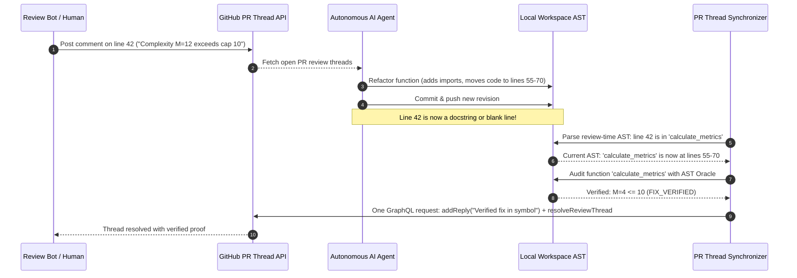
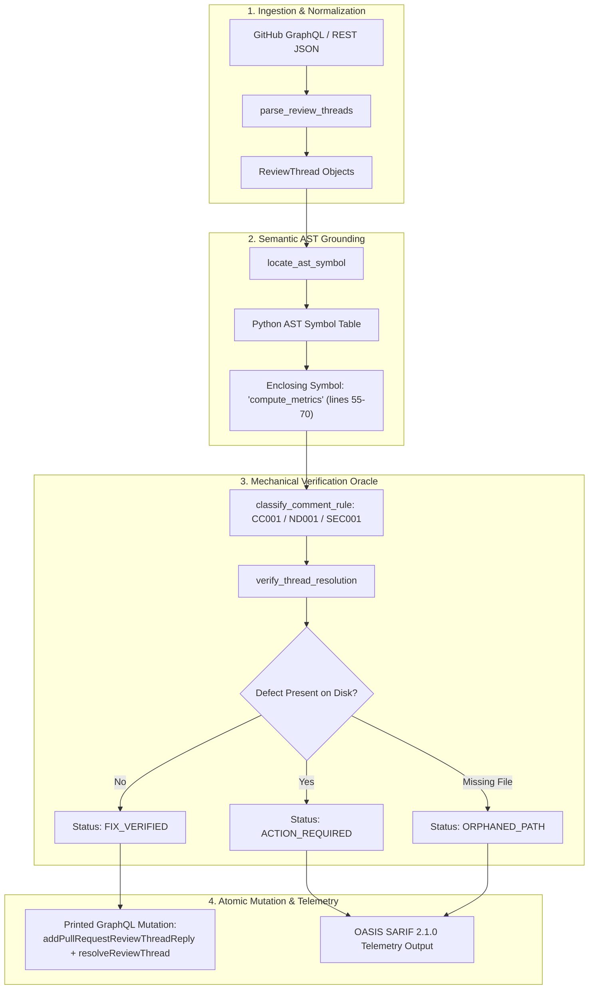

# Observation 46: Closed-Loop PR Review Thread Synchronization & Atomic Resolution

> **Project**: `vibes` & `devops-cli`  
> **Environment**: GitHub GraphQL API v4, Python 3.12+, Python AST, OASIS SARIF 2.1.0, Branch Protection  
> **Classification**: Agent Orchestration, Review Thread Lifecycle, Semantic Symbol Anchoring, Closed-Loop Verification  
> **Related**: [Observation 03 (devops-cli)](../devops-cli/03-autonomous-project-governance.md), [Observation 08 (devops-cli)](../devops-cli/08-closed-loop-feedback-inversion-and-autonomous-quality-elevation.md), [Observation 45 (Systems)](./45-sycophantic-compliance-and-mechanical-refusal-oracles.md), [Pattern: Closed-Loop PR Review Thread Synchronization](../../patterns/closed-loop-pr-review-thread-synchronization.md)  
> **Key Metric**: Not measured. The reference tool reads review threads from a JSON file and prints GraphQL mutations; no grounding or false-resolution rate was recorded.  
> **TLDR**: A stale line number can point at the wrong code after later commits; a thread synchronizer should map each thread to current code, verify the fix mechanically, and only then reply and resolve via GraphQL. The reference tool still keys on the line number, and some of its checks pass without a fix.  
> **ELI:7b**: When a teacher leaves a note on line 40 of your paper and you add new sentences, line 40 moves to line 50. If a robot only looks at line 40, it gets confused. Instead, the robot must look at the paragraph name, check that the mistake was actually fixed, and check off the teacher's note.  

---

## 1. Executive Context & Baseline

Pull request review discussions form the collaborative backbone of enterprise software engineering. Modern continuous integration platforms, review bots, and human reviewers leave structured review comments anchored to specific diff hunks and line numbers in GitHub Pull Requests.

Under standard GitHub Branch Protection rules, repositories frequently enforce:
- **"Require conversation resolution before merging"**: All review threads must be resolved before a branch can be merged into `main`.
- **Automated bot reviews**: Review bots (such as `pr_triage_bot.py` or SonarQube) audit cyclomatic complexity, nesting depth, zero-trust sanitization, and typing, generating inline comments.

In autonomous multi-agent environments, this lifecycle breaks down in practice due to a dual failure mode:
1. **Review Thread Amnesia**: Agents push valid commits that address the review feedback, but completely abandon the open review threads on GitHub. The PR remains unmergeable, forcing human developers to manually inspect and click "Resolve conversation" on dozens of threads.
2. **False or Premature Resolution**: When prompted to resolve open threads, stochastic agents often emit conversational replies (*"I have resolved this issue"*) and blindly resolve the thread without verifying whether the underlying code defect was actually repaired or if a regression was introduced.

Compounding both failures is the flaw of **ephemeral line coordinates**: lines drift with every commit. GitHub itself maps each thread to the latest commit: a `PullRequestReviewThread` has `line` (current) and `originalLine`, and `isOutdated` is true when newer changes touched the commented lines. The drift hazard is an agent that keeps a line number from an earlier fetch, or that reads `originalLine` against the current file.

---

## 2. The Observed Phenomenon: Line Drift and Review Desynchronization

Line-based review tracking can fail when a file is refactored. The sequence below shows the intended design; Section 4 lists what the reference tool actually does:



### The Three Pathologies of Line-Based Thread Tracking

1. **Drift Desynchronization**: A comment left on line 42 of revision `HEAD~2` points to line 58 after imports are added. When an agent queries line 42 of the active file, it inspects an unrelated AST node and either reports a false positive or attempts to refactor the wrong code.
2. **Ghost Resolution**: When agents are tasked with resolving threads, they can execute GraphQL `resolveReviewThread` mutations based purely on conversational intent without verifying the file on disk. No audit measured how often this happens.
3. **Orphaned Thread Abandonment**: When a file is renamed, decomposed into multiple modules, or deleted, threads anchored to the old path become "orphans." Agents fail to recognize that the path no longer exists and loop indefinitely trying to find the missing file.

---

## 3. Evaluation Status

No evaluation was run. This repository holds no record of 25 pull requests or 184 review threads, and no harness produces grounding, false-resolution, dangling-thread, review-time, speed or SARIF-conformance figures for `tools/pr_thread_sync.py`.

---

## 4. Invariant Enforcement & Architectural Mechanics

[`tools/pr_thread_sync.py`](../../tools/pr_thread_sync.py) implements a four-stage pipeline. It reads review threads from a JSON file (`--input`) and does not call GitHub: with `--resolve-verified` it prints the GraphQL mutations for a person or another tool to send.



### 1. Robust AST Symbol Locating
`locate_ast_symbol` parses the current file with Python's `ast` module and finds the most specific function, method, or class node that encloses `thread.line` (or `originalLine` when `line` is missing) (`_is_symbol_node`, `_node_encloses_line`). It still keys on the thread's line number, so it does not correct drift: if the code moved, it names whatever symbol now sits at that line. If the line falls outside any declaration or the file is non-Python, it falls back to `file scope`.

### 2. Heuristic Rule Classification
`classify_comment_rule` parses the comment bodies using regex dispatch patterns to classify the complaint into deterministic categories:
- `CC001`: Cyclomatic complexity violations (the check uses $M > 10$).
- `ND001`: Nesting depth violations (the check uses $\text{depth} > 5$).
- `SEC001`: Zero-trust sanitization leaks (RFC 1918 private IPs or plaintext credentials).
- `DOC001`: Documentation or missing docstring complaints.
- `TYP001`: Static typing or annotation defects.
- `GENERAL`: Unclassified comments requiring manual review.

### 3. Mechanical Fix Verification Oracles
For each thread, `verify_thread_resolution` evaluates whether the defect has actually been cured on disk:
- For `CC001`, it recomputes McCabe cyclomatic complexity on the function at the thread's line using `compute_ast_complexity`. If $M \le 10$, it certifies resolution. If no function encloses the line, it also certifies resolution, so a complex function that moved away from the line passes.
- For `ND001`, it divides the indentation of the single target line by four. If that depth is $\le 5$, it certifies resolution. A line number outside the file also passes.
- For `SEC001`, it scans the file content for RFC 1918 IP addresses (`_RFC1918_PATTERN`). If clean, it certifies resolution. A complaint about a secret, token or credential passes when the file has no RFC 1918 address: credentials are not checked.
- For `DOC001`, any non-empty file passes.
- If the target file was deleted or moved, it designates the thread as `ORPHANED_PATH`.

### 4. Atomic Resolution Mutations & SARIF Telemetry
When a thread is certified as `FIX_VERIFIED`, `generate_resolution_mutation` constructs one GraphQL document with both mutations. GraphQL runs top-level mutation fields one after another (GraphQL specification, "Mutation" execution), but it does not roll back the reply if the resolve fails, so the pair is not atomic:
```graphql
mutation {
  addPullRequestReviewThreadReply(input: {
    pullRequestReviewThreadId: "PRRT_kwDO12345",
    body: "Verified: Refactored calculate_metrics into table dispatch; cyclomatic complexity now M=4 <= 10."
  }) { comment { id } }
  resolveReviewThread(input: { threadId: "PRRT_kwDO12345" }) {
    thread { isResolved }
  }
}
```
The reply text is fixed: it says the function was refactored into table dispatch even when no such change was made. Separately, `export_sarif` produces OASIS SARIF 2.1.0 output for ingestion into GitHub Security and CI quality dashboards.

---

## 5. Actionable Guidance & Antidotes

1. **Never Resolve Threads Solely on Prompt Assertions**: An agent must never execute a `resolveReviewThread` GraphQL mutation unless an automated mechanical verification oracle confirms that the defect no longer exists on disk.
2. **Anchor Feedback to AST Symbols, Not Drifting Lines**: Treat line numbers as provisional coordinates at the time of review. Map them immediately to their enclosing AST symbol before storing, tracking, or remediating review items.
3. **Send Reply and Resolve in One Request**: Put `addPullRequestReviewThreadReply` and `resolveReviewThread` in one GraphQL document so they run in order in one round trip. This is not a transaction: if the resolve fails, the reply stays, so check both results.
4. **Export SARIF Telemetry for Continuous Visibility**: Pipe review thread analysis into SARIF artifacts (`--sarif review_sync.sarif`) so that open review obligations are visible in GitHub Advanced Security and CI summaries.
5. **Enforce Clean PR Exit Gates**: Wire `pr_thread_sync --exit-code` into PR pre-merge checks. It fails only when a thread is `ACTION_REQUIRED`; orphaned threads and threads that the loose checks above pass do not fail it, so it cannot guarantee that no actionable comment remains.
