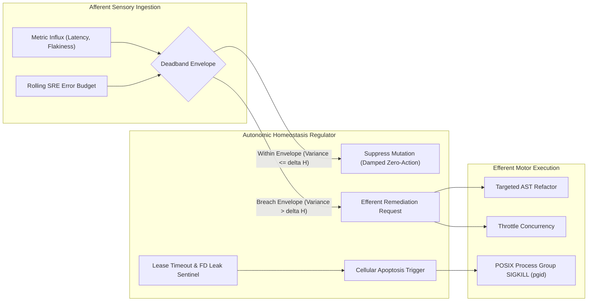

# Observation 47: Biological Autopoiesis, Homeostatic Damping & Afferent Observability

> **Project**: `vibes` & `devops-cli`  
> **Environment**: Python 3.12+, OpenTelemetry, Prometheus, FastMCP, Invariant Oracles, Local Silicon  
> **Classification**: Autonomic Systems, Autopoiesis, Afferent Telemetry, Homeostatic Damping, Cellular Apoptosis  
> **Related**: [Observation 01 (Systems)](./01-distributed-telemetry-and-agent-waterfalls.md), [Observation 22 (Systems)](./22-self-correction-loops-vs-cegis-constraint-accumulation.md), [Observation 28 (Systems)](./28-recursive-self-improvement-and-the-post-harness-mandate.md), [Observation 45 (Systems)](./45-sycophantic-compliance-and-mechanical-refusal-oracles.md), [Empirical Foundations §7](../../docs/EMPIRICAL_FOUNDATIONS.md#7-assertion-6-recursive-iteration-as-biological-homeostasis--afferent-observability), [Taxonomy §6](../../docs/TAXONOMY.md#6-the-metabolic--biological-execution-topology-autopoietic-systems)  
> **Key Metric**: Not measured. The regulator in Section 4 is a test fixture; this observation reports no churn, termination, cost or latency figures.  
> **TLDR**: Closed-loop self-repair that reacts to every transient signal can churn code; feeding telemetry back to agents through deadband thresholds, and killing stuck worker process groups, limits this. The biological terms are analogies.  
> **ELI:7b**: If your body shivered or sweated at every fraction of a degree change in the air, you would collapse from exhaustion. Biological bodies use deadbands so they only react when temperatures really drift. Autonomous coding agents need the same deadbands so they don't rewrite code on every tiny flicker of test noise.  

---

## 1. Executive Context & Baseline

Software engineering has historically treated codebases as static mechanical structures: blueprints drafted by architects, manufactured by programmers, and inspected post-hoc by quality assurance oracles. Once compiled and deployed, mechanical software does not regenerate its own boundary walls, repair its decaying components, or adapt its internal topology to operational stress.

The convergence of autonomous AI agents, persistent execution harnesses, and deterministic AST verification oracles fundamentally alters this paradigm. When an agentic system is equipped with continuous background daemons (`sdlc_project_manager.py sync --watch`), Language Server Protocol sentinels (`--lsp`), and AST refactoring engines, the codebase starts to change itself through agents. This observation calls that **autopoietic** by analogy. In Maturana and Varela's sense (1972), an autopoietic system produces and maintains its own components and boundary; a codebase is changed by agents outside it, so the term is a metaphor here. So are afferent (signals that travel toward a control center), homeostasis, and apoptosis (programmed cell death).

However, introducing autonomous self-repair into software systems without biological regulatory mechanisms induces severe systemic pathologies:
1. **Afferent Telemetry Blindness**: Observability systems (logs, metrics, distributed traces) emit telemetry strictly outward to human dashboards, leaving autonomous agents blind to runtime health.
2. **Epistemic Oscillation (Hyper-Metabolic Churn)**: When agents act on raw telemetry without damping, minor transient variances (such as a 5ms latency fluctuation or a flaky network probe) trigger immediate, uncoordinated AST mutations, destabilizing production code.
3. **Apoptosis Resistance (Orphan Subagent Leaks)**: Ephemeral worker subagents can fail to terminate upon task completion or timeout, consuming host RAM, leaking file descriptors, and starving ambient system processes.

---

## 2. The Observed Phenomenon: Hyper-Metabolic Churn vs. Homeostatic Equilibrium

Connecting generative agents directly to undamped telemetry streams can make code unstable. No experiment in [`devops-cli`](https://github.com/dan-petty/devops-cli) or [`vibes`](https://github.com/dan-petty/vibes) recorded this:



### The Three Biological Pathologies of Undamped Autonomy

1. **Hyper-Metabolic Churn ($R_{\text{meta}} \gg 1.0$)**: Without a deadband, an agent can respond to intermittent latency jitter by refactoring the same code again and again, which turns transient noise into diff churn and regressions.
2. **Apoptosis Failure**: Subagents spawned to evaluate candidate patches can outlive their parent tasks. On Linux, `proc.kill()` signals only the immediate child (for example a shell), so that child's own children keep running as orphan processes, re-parented to PID 1 or the nearest subreaper. (A zombie is different: an exited process that its parent has not reaped.)
3. **Heterotrophic Caloric Depletion**: When every micro-iteration was routed to commercial frontier cloud APIs, the system spends token budget quickly, which makes continuous iteration expensive.

---

## 3. Mechanics & Root Cause Analysis

### Cybernetic Feedback Instability vs. Ashby's Law of Requisite Variety

W. Ross Ashby (1956) formulated the *Law of Requisite Variety*: a regulator $R$ can successfully control a system against disturbance $D$ only if the variety (number of available states) of $R$ equals or exceeds the variety of $D$:

$$V_R \ge V_D - V_O$$

Where $V_O$ is the acceptable outcome variety. In software, when environmental noise $D$ includes transient latency, network retries, and flaky test assertions, an agent lacking an internal deadband treats every fluctuation as a defect requiring code modification.

Furthermore, feedback control theory shows that a loop with delay ($\tau$) and high gain ($K$) can **oscillate**. Norbert Wiener's *Cybernetics* (1948, chapter IV, "Feedback and Oscillation") describes this hunting in machines and in purpose tremor. Without damping, the agent's corrective AST mutations can arrive out of phase with the system's actual state and amplify the swings.

### The Thermodynamic Cost of Knowledge (Landauer's Principle)

Rolf Landauer (1961) showed that erasing one bit of information dissipates at least $k_B T \ln 2$ of heat. That bound is far below the energy that GPUs actually use per operation, so it does not explain the cost of agent work. The real cost is ordinary compute: every discarded speculative exploration, hallucinated module, and rolled-back git branch used GPU time and energy.

By establishing **local autotrophic silicon** (dedicated hardware running quantized models like `devops-coder` and `devops-review` alongside in-memory AST oracles):
- The marginal token cost falls to electricity and hardware wear.
- The system transitions from **obligate heterotrophy** (relying on rented cloud APIs) to **metabolic autotrophy** (sustaining internal homeostasis on local power).
- Accumulated counterexamples and negative schemas prune candidate work before it reaches the model, which saves compute.

---

## 4. Countermeasures & Verification

A three-part regulatory design follows. Only part of it exists in code: [`tests/test_empirical_foundations.py`](../../tests/test_empirical_foundations.py) holds a test fixture, `AutonomicHomeostasisRegulator`, that classifies one telemetry sample against fixed thresholds. No runtime component uses it.

### 1. Afferent Telemetry & Deadband Envelopes

Observability is converted from an outward human artifact into an inward afferent signal. The fixture classifies an `AfferentTelemetry` sample (`execution_latency_seconds`, `cyclomatic_complexity`, `nesting_depth`, `test_failure_count`) against a `HomeostaticEnvelope`:

```python
@dataclass(frozen=True)
class HomeostaticEnvelope:
    max_latency_seconds: float = 2.0
    complexity_headroom_ceiling: int = 6
    max_nesting_depth: int = 3

# AutonomicHomeostasisRegulator.evaluate_metabolic_state, in order:
#   test_failure_count > 0                      -> ("CRITICAL_DEFECT", True)
#   complexity or depth above the ceiling       -> ("HEADROOM_EROSION", True)
#   latency > 1.5 * max_latency_seconds         -> ("METABOLIC_LATENCY_BREACH", True)
#   otherwise                                   -> ("EQUILIBRIUM", False)
```

The deadband is the latency band between `max_latency_seconds` and 1.5 times that value: a sample inside it causes no action. The fixture has no hysteresis (no separate enter and exit thresholds, and no state), and it does not check that a breach is sustained: one sample decides.

### 2. Cellular Apoptosis for Subagent Containment

When a worker subagent stops responding (heartbeat timeout, leaked process groups, or memory boundary breaches), kill its whole process group; this observation calls that apoptosis. The repository has no `enforce_cellular_apoptosis` function. Process-group kills appear in `examples/ephemeral-container-sandbox/sandbox.py` and `examples/worktree-swarm-arbiter/worktree_arbiter.py` (`os.killpg`). A minimal sketch:

```python
def enforce_cellular_apoptosis(subagent_id: str, pgid: int, caller_pgid: int) -> bool:
    """Terminate malfunctioning subagent process hierarchy cleanly."""
    if pgid <= 1 or pgid == caller_pgid:
        return False  # Protect container init and caller
    os.killpg(pgid, signal.SIGKILL)
    return True
```

### 3. Verification Protocol

`test_closed_loop_afferent_telemetry_homeostatic_damping()` asserts that:
- A healthy sample, and a latency of 2.5 s (inside the deadband), return `("EQUILIBRIUM", False)`.
- A complexity of 8 returns `("HEADROOM_EROSION", True)`.
- A latency of 4.2 s returns `("METABOLIC_LATENCY_BREACH", True)`.

No test covers process-group termination.

---

## 5. Architectural Invariants & Evaluation Status

No churn ratio, telemetry latency, termination success rate, token cost or convergence rate was measured for this design.

Feeding telemetry back to agents through deadbands, and killing stuck workers by process group, are sound control practices. They limit churn and leaked processes; they do not make software self-maintaining.
