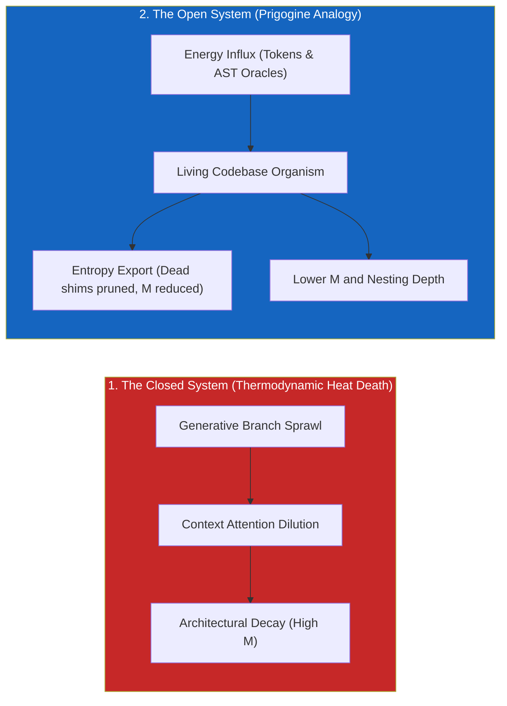
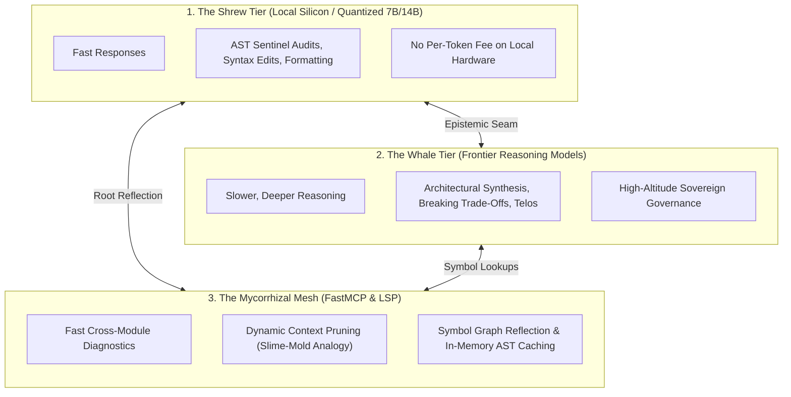

# Observation 49: Dissipative Structures, Turing Morphogenesis & Allometric Swarm Scaling

> **Project**: `vibes` & `devops-cli`  
> **Environment**: Autonomous multi-agent engineering sessions, AST invariant sentinels, local silicon quantization, FastMCP tool mesh  
> **Classification**: Non-Equilibrium Thermodynamics, Allometric Scaling, Reaction-Diffusion Morphogenesis, Ecological Swarms  
> **Related**: [Observation 05 (devops-cli)](../devops-cli/05-harness-slots-and-subagent-offloading.md), [Observation 28 (Systems)](./28-recursive-self-improvement-and-the-post-harness-mandate.md), [Observation 47 (Systems)](./47-biological-autopoiesis-homeostatic-damping-and-afferent-observability.md), [Observation 48 (Systems)](./48-the-improv-axiom-and-generative-headroom-elevation.md)  
> **Key Metric**: Not measured. The thermodynamic and biological terms are analogies; no entropy, complexity, cost or latency figure was recorded.  
> **TLDR**: By analogy with open thermodynamic systems, a codebase stays simple only while work keeps removing complexity; pair generating models with fast mechanical checks, and route small tasks to small models and hard tasks to large ones.  
> **ELI:7b**: If you never clean your room, it naturally gets messy over time (entropy). Traditional codebases do the same thing. AI codebases survive by acting like living cells: eating compute energy, constantly throwing away dead code, and pairing fast hummingbird models with deep-thinking whale models so they never run out of breath.  

---

## 1. Executive Context & Baseline

Lehman’s Laws of Software Evolution (from 1974) state that as an evolving system changes, its complexity increases unless work is done to maintain or reduce it. This resembles the **Second Law of Thermodynamics**, under which the entropy of an isolated system does not decrease. The resemblance is an analogy: code complexity is not thermodynamic entropy.

In the post-harness era ([Observation 28](./28-recursive-self-improvement-and-the-post-harness-mandate.md)), the convergence of local neural silicon, Language Server Protocols, and deterministic AST verification makes that maintenance work cheaper. It does not break Lehman's law, which already allows complexity to fall when work is done to reduce it.

This observation borrows three lenses: **Ilya Prigogine's Non-Equilibrium Thermodynamics** (Nobel Prize, 1977), **Alan Turing's Morphogenesis** (1952), and **Max Kleiber's Allometric Scaling** (1932). They are metaphors for software, not laws that apply to it.

---

## 2. The Observed Phenomenon

Unconstrained agentic development can produce three pathologies. No benchmark in [`devops-cli`](https://github.com/dan-petty/devops-cli) or [`vibes`](https://github.com/dan-petty/vibes) measured them:

### The Three Ecological Pathologies of Naïve Swarms:

1. **Thermodynamic Heat Death ($d_i S \gg 0$)**: Without mechanical checks, language models tend to emit procedural branching sprawl, and function complexity can rise with each feature until it breaches the $M \le 10$ cap.
2. **Allometric Metabolic Starvation**: Routing routine syntax edits, docstring formatting, and file discovery to high-mass frontier reasoning models consumes token budget quickly and adds API latency to every small step.
3. **Unmyelinated Context Drag**: Agents operating without semantic symbol indexing crawl files linearly and spend much of their prompt budget re-reading boilerplate rather than executing edits.

---

## 3. The Underlying Failure Mode or Catalyst

### 1. Prigogine’s Entropy Balance in Software

In Prigogine's non-equilibrium thermodynamics, the entropy change $dS$ of an open system is split into an internal production term and an exchange term:

$$dS = d_i S + d_e S$$

Where:
* $d_i S \ge 0$ is internal entropy generated by state transitions (e.g. new code synthesis, edge-case branching, architectural modifications).
* $d_e S$ is the entropy exchanged with the outside environment.

For an isolated system, $d_e S = 0$, so entropy does not decrease ($dS = d_i S \ge 0$).  
By analogy, deleting dead shims, compacting attention contexts, and refactoring procedural sprawl into declarative tables play the role of **entropy export**, a strongly negative $d_e S$:

$$|d_e S| > d_i S \implies dS < 0$$

Under this analogy, the codebase can get simpler as features are added (**rejuvenation**). No entropy quantity of a codebase is defined or measured here.

### 2. Turing Reaction-Diffusion in Code Architecture

Alan Turing (1952, "The Chemical Basis of Morphogenesis") showed mathematically that two reacting chemicals that diffuse at different rates can form stable patterns (stripes, spots). Gierer and Meinhardt (1972) later framed this as a short-range **Activator** and a long-range, faster-diffusing **Inhibitor**.

In autonomous software synthesis:
* The **Generative Model** is the Activator: striving locally to synthesize code and expand capability horizons.
* The **AST Invariant Sentinel** ($M \le 10$, depth $\le 5$) is the Inhibitor: diffusing rapidly across the tree to reject complexity.
* Bounded together, they produce **Architectural Morphogenesis**: clean, self-differentiating packages and interfaces emerge organically without monolithic upfront human blueprints. This is an analogy: no reaction-diffusion process runs in a codebase, and no measurement shows that packages emerge this way.

### 3. Kleiber’s Allometric Scaling Law ($B \propto M^{3/4}$)

Kleiber's law (Kleiber, 1932, *Hilgardia*) states that an animal's basal metabolic rate scales with about the 3/4 power of its body mass. In biology, a 2g shrew’s heart beats 1,500 times a minute in a rapid, low-latency sprint; a 150,000kg blue whale glides with immense efficiency, reserving its massive energy for long-range navigation. The law says nothing about language models; the shrew and the whale are a metaphor for routing tasks by size.

In multi-tier swarms, forcing a frontier reasoning model (the whale) to fix comment typos is biological madness; forcing a 7B local model (the shrew) to design distributed consensus tends to fail. Matching cognitive mass to task tempo is an ecological mandate.

---

## 4. Remediation & Architectural Pattern

To anchor these natural principles mechanically, we codified [`patterns/dissipative-entropy-reduction-and-allometric-swarm-routing.md`](../../patterns/dissipative-entropy-reduction-and-allometric-swarm-routing.md):

### Key Architectural Mechanisms:

1. **The Non-Equilibrium Entropy Pump**: Enforcing the **Delete-On-Sight rule** in pre-1.0 software. Every pull request that introduces a replacement capability must ruthlessly eliminate the legacy shim, exporting entropy in the same commit.
2. **Mycorrhizal Diagnostic Delivery**: Leveraging FastMCP and Language Server Protocols as underground root fungi. An LSP server that analyzes cross-module references can report a broken caller as soon as a signature changes, before tests run. The sentinel's LSP server checks only the open document.
3. **Slime-Mold Context Routing (*Physarum polycephalum*)**: Dynamic context pruning that thickens AST attention around files with active invariant friction while allowing untouched modules to wither out of token budgets. No code in this repository implements it.

---

## 5. Verifiable Impact & Key Takeaways

No measurement was made, so this observation has no entropy, token cost, diagnostic latency, attention or modularity figures. The thermodynamic and biological terms in it are analogies.

### Summary Maxims for Practitioners:

> [!IMPORTANT]
> **Treat code like an open system.** Software does not obey the Second Law. The analogy says that code nobody maintains accumulates complexity, and that steady removal of dead code and sprawl keeps it simple.

- **Match the cognitive mass to the task:** Let shrews handle syntax and let whales steer architecture.
- **Connect through the root mesh:** Never let subagents crawl code linearly when a symbol graph can answer the lookup.
- **The wolf preserves the forest:** Bounding models with hard invariant predators is what creates modular architectural beauty.
