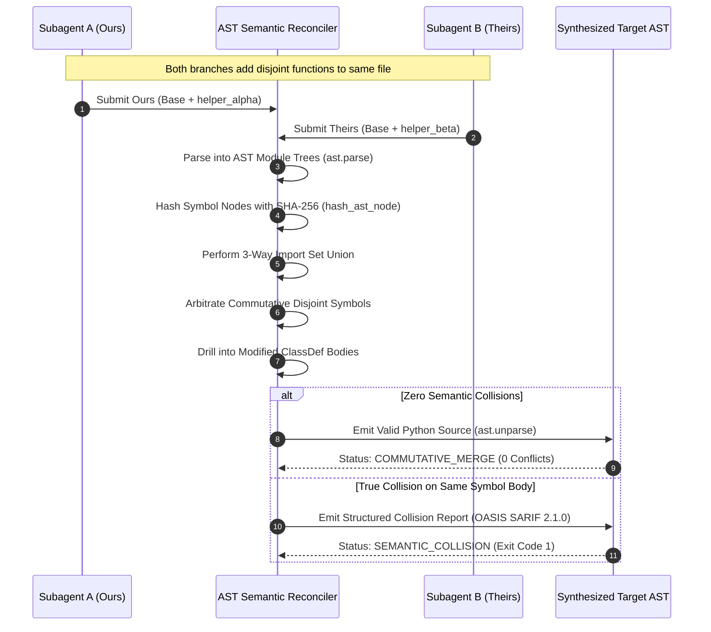

# Pattern: 3-Way AST Semantic Reconciliation

> **Pattern Class**: Multi-Agent Concurrency & AST Engineering  
> **Problem**: Line-oriented git merges (the `ort` strategy, `git merge-file`) report a textual conflict when concurrent subagents add independent functions, methods, or imports at the same place in the same file  
> **Solution**: Decompose source files into AST symbol trees, arbitrate commutative symbol additions, unify import sets, and emit valid Python code or structured collision diagnostics  
> **TLDR**: Arbitrate concurrent subagent git merge conflicts using name-keyed AST symbol maps and 3-way import unions rather than line-based text diffs.
> **ELI:7b**: When two AIs edit the same file, don't look at line numbers. Look at the actual functions and combine them by name, so two new functions in the same spot do not clash.
> **Reference Implementation**: [`examples/ast-semantic-reconciler/`](../examples/ast-semantic-reconciler/)

---

## 1. Problem Statement: The Spurious Collision Tax

When autonomous subagents operate in parallel git worktrees ([`worktree-swarm-arbiter`](../examples/worktree-swarm-arbiter/)), they frequently branch from a common ancestor commit (`Base`) and make independent, non-conflicting improvements to the same target files:
- Subagent A adds a new test utility function at the end of `helpers.py`.
- Subagent B adds a different validation function at the end of `helpers.py`.

Because both subagents append at the same line offset, Git's textual 3-way merge flags a **false merge conflict** (`git merge-file` exits 1 on this input; additions at different places in the file merge cleanly):

```text
<<<<<<< HEAD
def validate_payload(data: dict) -> bool:
    return bool(data)
=======
def sanitize_key(key: str) -> str:
    return key.strip().lower()
>>>>>>> feat/subagent-b
```

This textual collision forces expensive agent replanning, manual review cycles, or worse, unhandled `SyntaxError` crashes when conflict markers are accidentally committed.

---

## 2. The Architectural Pattern: Commutative AST Symbol Reconciliation

Instead of treating source code as opaque lines of text, the **3-Way AST Semantic Reconciliation** pattern treats source files as **name-keyed symbol maps** where top-level definitions (imports, functions, classes, constants) can be reconciled with grammatical awareness.



---

## 3. Core Invariants

1. **Guaranteed Syntactic Integrity**:
   - The merged output is generated by `ast.unparse()`, so it never contains raw textual conflict markers (`<<<<<<<`). The reference implementation compiles the merged output with `compile(source, "<merged>", "exec")`, which does not run it. If the compile fails, it reports a collision and writes no code. `ast.parse()` alone is not sufficient, because it accepts code that Python refuses to compile, for example a `from __future__` import after other imports.
2. **Commutative Disjoint Addition Preservation**:
   - When both branches add symbols not present in `Base`, if their identifiers are distinct, both symbols are retained in the merged AST, so this class of false conflict does not occur. The set of merged symbols does not depend on which branch is `Ours`; their text order does (base, then ours, then theirs; in a merged class body, ours, then theirs).
3. **Deterministic Import Set Union**:
   - Imports added by either branch are combined via 3-way set difference:
     $$I_{\text{merged}} = (I_{\text{ours}} \cup I_{\text{theirs}}) \setminus (I_{\text{base}} \setminus (I_{\text{ours}} \cap I_{\text{theirs}}))$$
     Imports are deduplicated. `from __future__` imports come first, right after the module docstring, as Python requires. The other imports are sorted deterministically by statement text (`sorted()`), not into PEP 8 groups.
4. **Hierarchical Class Member Arbitration**:
   - A class that only one branch changed is taken whole from that branch.
   - When concurrent branches modify the same `class`, the reconciler arbitrates each member of the class body with the same rules as the module: the docstring, attributes, methods, nested classes and other statements. Disjoint additions from both branches are all kept, and the class docstring stays first.
   - The class header (decorators, bases, keywords) is arbitrated as one more symbol. Different header changes in both branches are a collision on the class.
5. **Non-Destructive Collision Isolation**:
   - When both branches make incompatible edits to the exact same function body, the engine produces a structured collision report (symbol name, kind, and the base, ours and theirs source of the symbol) and OASIS SARIF 2.1.0 output that locates each collision as `symbol://<name>`, with no line or column. An agent can use the report to correct its edit.

---

## 4. Implementation Protocol

### Step 1: Symbol Decomposition
Decompose each input AST (`Base`, `Ours`, `Theirs`) into:
- Leading docstring (`ast.Expr`)
- Import sets (`ast.Import`, `ast.ImportFrom`)
- Top-level symbol map keyed by name (`FunctionDef`, `ClassDef`, `Assign`, `AnnAssign`)

### Step 2: 3-Way Arbitration
For each unique symbol across the three variants:
- If unchanged in `Ours` relative to `Base`, adopt `Theirs`.
- If unchanged in `Theirs` relative to `Base` or identical in both, adopt `Ours`.
- If both branches changed a `ClassDef`, recursively arbitrate each member of the class body (docstring, attributes, methods, nested classes) with these same rules.
- If disjoint additions, include both commutatively.
- Otherwise, record a `CollisionReport`.

### Step 3: Synthesis & Verification
Assemble the docstring (once), the merged imports (`from __future__` imports first), and the reconciled statements. Unparse using `ast.unparse()`. Compile the result with `compile(source, "<merged>", "exec")`. If the compile fails, report a collision and write no code.

---

## 5. Reference Implementation

See [`examples/ast-semantic-reconciler/`](../examples/ast-semantic-reconciler/):
- [`ast_reconciler.py`](../examples/ast-semantic-reconciler/ast_reconciler.py): Example implementation; passes AST Invariant Sentinel `--preset strict` ($M \le 6$, depth $\le 3$).
- [`test_reconciler.py`](../examples/ast-semantic-reconciler/test_reconciler.py): Full test suite validating commutative functions, class member merging, docstrings, import union, the compile check, and SARIF telemetry.

Limits of the example: `ast.unparse()` drops all comments and source formatting. Treat the output as a merge proposal for review, not as a drop-in `git` merge driver.
