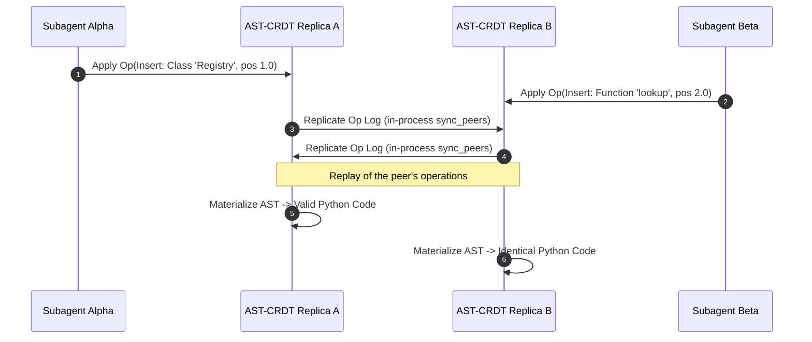

# Pattern: AST-CRDTs for Real-Time Agent Collaboration

> **Pattern Class**: Multi-Agent Concurrency & Distributed Systems  
> **Problem**: Real-time concurrent code authoring by multiple autonomous agents can cause token splitting and character-level syntax corruption under standard text CRDTs  
> **Solution**: Replicate Abstract Syntax Tree (AST) nodes as first-class distributed entities governed by Lamport timestamps, sibling position keys, and tree mutation operations  
> **TLDR**: Replicated tree collaborative editor treating AST nodes as first-class distributed entities with Lamport clocks, so concurrent edits cannot interleave characters inside a token.
> **ELI:7b**: Let multiple AI helpers type in the same file simultaneously without scrambling each other's code or messing up the grammar.
> **Reference Implementation**: [`examples/ast-crdt-collaborative-editor/`](../examples/ast-crdt-collaborative-editor/)

---

## 1. Problem Statement: The Lexical Hazard of Text CRDTs

When multiple autonomous agents (e.g. an architect and an implementation worker) edit the same source file concurrently in real time, text CRDTs (RGA, and the text types of Yjs and Automerge) treat code as an unstructured sequence of characters:
- Characters from concurrent edits can interleave, splitting identifier names (`def val_tok_id()`). Logoot and LSEQ interleave character by character; RGA shows a lesser form when text is prepended ([Kleppmann et al., PaPoC 2019](https://doi.org/10.1145/3301419.3323972)). Even without interleaving, two edits that are each valid can merge into invalid code.
- Indentation shifts across block boundaries corrupt Python and YAML structure.
- Downstream interpreters fail with unhandled `SyntaxError`, forcing costly error-correction loops.

---

## 2. The Architectural Pattern: Replicated AST Tree Data Types

The **AST-CRDT** pattern elevates distributed replication from character offsets to **grammatical AST syntax nodes**. A CRDT proper guarantees that replicas which received the same operations converge, in any delivery order ([Shapiro et al., SSS 2011](https://doi.org/10.1007/978-3-642-24550-3_29)). The reference implementation is an in-process simulation that does not meet that bar: it shows the data model, not a proven CRDT.

---

## 3. Core Principles

1. **Syntactic Unit Granularity**:
   - Mutations operate on semantic nodes (`IMPORT`, `CLASS`, `FUNCTION`, `DECORATOR`, `STATEMENT`) rather than individual characters.
2. **Fractional Sibling Ordering**:
   - Sibling order within a parent node is set by position keys, with ties broken by immutable node identifiers (`agent:lamport:counter`). A real implementation needs dense keys (for example rationals); the reference implementation stores keys as strings and compares them lexicographically, so `"10.0"` sorts before `"2.0"`.
3. **Strong Eventual Consistency (SEC)**:
   - Target property: any two replicas that have processed the same set of operations converge to the exact same AST state, regardless of operation arrival order. The reference implementation does not provide it. Two concurrent moves of the same node to different parents leave the replicas with different parents, and an insert that arrives before its parent attaches to the root and stays there.
4. **Deterministic Cycle Prevention (`CRDT001`)**:
   - A move that would make a node its own ancestor in the replica's current state is rejected and recorded as `CRDT001`, so each replica stays acyclic. The reference implementation does not compare Lamport timestamps here, so replicas can reject different moves and diverge.

---

## 4. Invariant Rules Summary

- **`CRDT001`**: Directed Cycle Induction Hazard.
- **`CRDT002`**: Orphan Node Hazard (insertion under deleted parent).
- **`CRDT003`**: Causal Inversion / Out-of-Order Delivery.
- **`CRDT004`**: Syntactic Invariant Invalidation.
- **`CRDT005`**: Tombstone Memory Saturation.

The reference implementation emits only `CRDT001` and `CRDT002`; `CRDT003` to `CRDT005` are declared but never raised.
