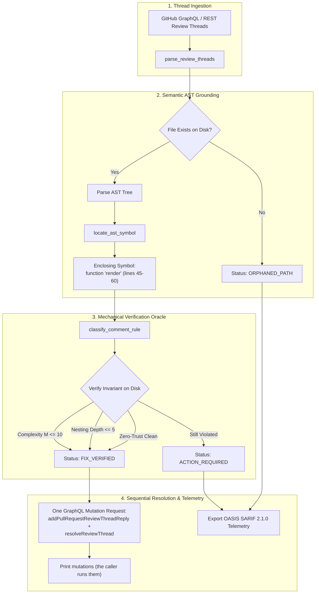

# Pattern: Closed-Loop PR Review Thread Synchronization — AST-Anchored Feedback Remediation & Sequential Resolution

> **Pattern Class**: Agent Orchestration & Review Lifecycle  
> **Problem**: Autonomous agents often push valid code fixes but fail to resolve GitHub PR review threads, get misled by drifting line coordinates, or hallucinate thread resolutions without verifying that the defect is fixed on disk.  
> **Solution**: Anchor review threads to semantic AST symbols rather than brittle line numbers, verify remediations against mechanical invariant oracles, and emit single-request reply-and-resolve GraphQL mutations with SARIF telemetry.  
> **Reference Implementation**: [`tools/pr_thread_sync.py`](../tools/pr_thread_sync.py) — `synchronize_threads`, `verify_thread_resolution`, `locate_ast_symbol`, `generate_resolution_mutation`  
> **TLDR**: Ground PR review comments in AST symbols, mechanically verify that the defect is cured on disk, and resolve threads via one GraphQL mutation request per thread.  
> **ELI:7b**: Line numbers change whenever you add code, confusing AI helpers. By attaching comments to the function name, checking that the bug is really gone, and answering the reviewer automatically, the robot keeps your PR clean and ready to merge.  

---

## Problem Statement

Continuous integration and automated review personas post granular review comments on GitHub Pull Requests to flag complexity violations, deep nesting, missing documentation, or security leaks. When branch protection enables "Require conversation resolution before merging", all conversation threads must be marked resolved before a pull request merges into `main`.

However, autonomous engineering agents encounter three critical failure modes during PR iteration:

1. **Review Thread Amnesia**: Agents address the core feedback in source code, commit, and push, but abandon the PR review threads in an unresolved state on GitHub. This leaves the PR blocked by branch protection, demanding manual human intervention.
2. **Ephemeral Line Drift**: Review comments are anchored to diff line numbers at the moment of review. As the agent refactors the file, earlier lines are added or removed, causing line coordinates to drift. When querying the file at the original line number, the agent inspects unrelated code, producing false positives or damaging unrelated statements.
3. **Ghost Resolutions**: When prompted to resolve open threads, agents frequently call GraphQL resolution mutations based purely on conversational intent without verifying whether the underlying code defect was actually repaired or if a regression was introduced.

---

## Core Mechanics

The **Closed-Loop PR Review Thread Synchronization** pattern replaces naive line-based inspection and unverified conversation closing with a deterministic four-phase verification pipeline:



### The Four Operational Phases

1. **Payload Ingestion & Normalization**:
   - `parse_review_threads` deserializes review thread trees from either GitHub GraphQL API v4 (`data.repository.pullRequest.reviewThreads.nodes`) or REST JSON exports.
   - Extracts thread IDs, resolution states, target relative file paths, and chronological comment bodies.

2. **Semantic AST Grounding**:
   - `parse_review_threads` keeps the review-time symbol name: the node's `symbolName` field, else the definitions that enclose the commented line in the first comment's `diffHunk`.
   - With `--base-root`, a directory that holds the base version of the files (the version that the review was made on), `resolve_review_symbol` names the definitions that enclose the review-time line in that version, for example `B.run`. The hunk header can name the class of a method or the function above the line, so the tool uses the diff hunk only when the base lookup fails.
   - `locate_ast_symbol` loads the target file from the active branch, traverses the abstract syntax tree (`ast.walk`) and finds the definition of that name wherever it moved (`find_symbol_by_name`).
   - A thread with no symbol name falls back to the function, method, or class declaration that spans the thread's `line`. GitHub moves `line` with the diff while the thread is current; for an outdated thread the tool falls back to `originalLine`, which can point at a different symbol after the file changed.
   - Converts numeric coordinates into semantic coordinates (e.g. `function 'calculate_scores' (lines 40-58)`) for the report.

3. **Mechanical Verification Oracles**:
   - `classify_comment_rule` parses review comments against invariant rules (`CC001`, `ND001`, `SEC001`, `DOC001`, `TYP001`).
   - Directly executes the relevant deterministic checker against the file on disk:
     - Scores the named function with radon's cyclomatic complexity (`metric_reference.cyclomatic_complexity`).
     - Measures the indentation depth of the target line (leading spaces divided by 4).
     - Scans the whole file for RFC 1918 private IP leaks (`_RFC1918_PATTERN`).
     - For `DOC001`, requires a non-empty docstring on the named definition. That shows that a docstring exists, not that a typo or a link was fixed.
     - A `CC001` or `DOC001` thread whose definition cannot be found stays `ACTION_REQUIRED`: no definition means no verified fix.
   - Computes explicit resolution state: `FIX_VERIFIED`, `ACTION_REQUIRED`, `RESOLVED`, or `ORPHANED_PATH`.

4. **Sequential Resolution & Standardized Telemetry**:
   - The reply states only what the tool measured. A `CC001` reply gives the symbol, its radon complexity now and in the base version, and the limit of 10. It does not say how the code changed.
   - For all `FIX_VERIFIED` threads, `generate_resolution_mutation` constructs one GraphQL mutation request combining reply publication and thread resolution. GraphQL runs the two mutations in order with no rollback, so a failed resolve leaves the reply in place. The tool prints the request; it does not send it.
   - `export_sarif` serializes findings into OASIS SARIF 2.1.0 format, linking review thread IDs, rule IDs, file paths, and resolution statuses for CI ingestion.

---

## Implementation Reference

The pattern is implemented in [`tools/pr_thread_sync.py`](../tools/pr_thread_sync.py):

```python
# Reply-and-resolve query generation: two mutations, run in order, no rollback
def generate_resolution_mutation(thread_id: str, reply_body: str) -> str:
    """Synthesizes a GraphQL mutation query to reply to and resolve a review thread."""
    sanitized_body = json.dumps(reply_body)
    return (
        f'mutation {{ addPullRequestReviewThreadReply(input: {{ pullRequestReviewThreadId: "{thread_id}", body: {sanitized_body} }}) '
        f'{{ comment {{ id }} }} resolveReviewThread(input: {{ threadId: "{thread_id}" }}) {{ thread {{ isResolved }} }} }}'
    )
```

CLI execution modes:
```bash
# Audit and summarize active review threads
python3 tools/pr_thread_sync.py --input threads.json --root .

# Export OASIS SARIF 2.1.0 telemetry for CI dashboards
python3 tools/pr_thread_sync.py --input threads.json --sarif threads.sarif

# Emit executable GraphQL mutations for verified threads
python3 tools/pr_thread_sync.py --input threads.json --resolve-verified

# Name each symbol from the reviewed version, and state the old complexity in CC001 replies
python3 tools/pr_thread_sync.py --input threads.json --base-root ../reviewed-worktree --resolve-verified

# Enforce clean PR gate (exit 1 if ACTION_REQUIRED threads remain)
python3 tools/pr_thread_sync.py --input threads.json --exit-code
```

---

## Invariants & Guardrails

1. **Zero Unverified Resolutions**: Never mark a thread resolved based solely on conversational LLM intent. Pre-flight AST or lint verification against active disk state is strictly mandatory.
2. **Single-Request Mutations**: Never separate reply generation from thread resolution. Send both in one GraphQL mutation request. GraphQL runs top-level mutation fields in order, but not as a transaction ([GraphQL spec, Mutation](https://spec.graphql.org/October2021/#sec-Mutation)): if `resolveReviewThread` fails, the reply stays, so check the response.
3. **AST Grounding Over Line Numbers**: Always translate diff line numbers to semantic symbol descriptors to survive file refactorings and line insertions.
4. **Standard Telemetry Output**: Always emit SARIF 2.1.0 payloads to maintain unified dashboard visibility across static analysis tools, review bots, and thread synchronizers.
