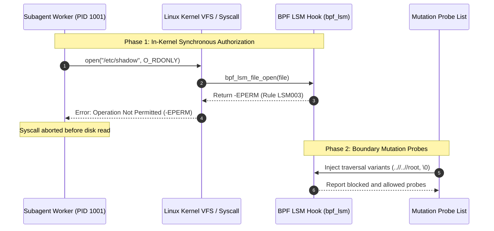

# Pattern: Kernel-Enforced LSM Sandbox Containment

> **Pattern Class**: Security Architecture & Kernel Gating
> **Problem**: Post-hoc user-space log monitors fail to prevent unrecoverable sandbox escapes and malicious socket calls by compromised subagents
> **Solution**: Synchronously intercept syscall operations at the Linux Security Module (BPF LSM) boundary and test containment with mutation probes
> **TLDR**: Intercept unauthorized execution, socket egress, and privilege escalation at the Linux Security Module (BPF LSM) boundary, before the operation completes.
> **ELI:7b**: Block unauthorized commands and network connections right inside the Linux kernel so rogue AI scripts are stopped before they can run.
> **Reference Implementation**: [`examples/ebpf-lsm-kernel-gate/`](../examples/ebpf-lsm-kernel-gate/)

---

## 1. Problem Statement: The Limits of User-Space Sandboxing

When autonomous AI coding agents execute terminal tools, compile code, and run tests, traditional user-space isolation suffers from three structural flaws:

1. **The Asynchronous Race Condition**:
   Passive monitoring frameworks (such as standard `auditd` or `kprobe`-based tracers) process security alerts after the syscall has completed. A process can send credentials over a TCP socket before a user-space daemon can issue a terminating signal.
2. **Path Normalization and Symlink Escapes**:
   User-space regex scanners evaluate raw command arguments rather than canonical VFS inode resolution. Attackers and hallucinating subagents exploit path variants (`/./`, `//`, `../`), symlink races, or null-byte injections to read sensitive files (`/etc/shadow`, `~/.ssh`).
3. **Binary Execution Smuggling**:
   Workloads restricted to specific developer tools can bypass shell-level constraints by invoking unwhitelisted binaries via disguised aliases or nested subshells.

---

## 2. The Architectural Pattern: In-Kernel Synchronous Gating

To close the detect-then-kill gap, isolation must reside directly within the operating system kernel's authorization path using **Linux Security Module (BPF LSM)** hooks.

The reference implementation does not do this. [`examples/ebpf-lsm-kernel-gate/lsm_gate.py`](../examples/ebpf-lsm-kernel-gate/lsm_gate.py) is a pure-Python simulation. It loads no BPF program and touches no kernel. Its file check normalizes `.`, `..` and repeated slashes before it matches, so it blocks `/etc/./shadow` and `/etc//shadow`; it does not resolve symbolic links. Its probe list has 31 inputs, and the path probes come from the policy. It is not [syzkaller](https://github.com/google/syzkaller), which is a coverage-guided kernel fuzzer that looks for kernel bugs. For kernel enforcement, the example emits a Cilium Tetragon `TracingPolicy` instead of BPF C.

### Core Invariants

1. **Pre-Execution In-Kernel Denial (`-EPERM`)**:
   Enforce security policies at `bpf_lsm_bprm_check_security`, `bpf_lsm_file_open`, and `bpf_lsm_socket_connect`. Any forbidden operation returns `-EPERM` immediately, aborting execution before data access or network packet dispatch.
2. **Zero-Trust Egress Isolation**:
   Block socket connections to private RFC 1918/4193 addresses and cloud metadata endpoints (`169.254.169.254`) directly in `bpf_lsm_socket_connect`, allowing only loopback communications (`127.0.0.1`).
3. **Boundary Mutation Probes**:
   Continuously probe the LSM policy with synthesized traversal strings, bitwise flag mutations, and IP variants. Probes find bypasses; they cannot prove that none exist. `lsm_gate.py fuzz` runs 31 probes and blocks 30 (rate 0.968); it allows `127.0.0.1` by design.
4. **Declarative Policy Synthesis**:
   Compile declared security policies into Kubernetes-native Cilium Tetragon `TracingPolicy` CRDs. `generate_tetragon_policy()` in `lsm_gate.py` reads the `LSMPolicy` and gives each kprobe a selector with a `Sigkill` action ([Tetragon selectors](https://tetragon.io/docs/concepts/tracing-policy/selectors/)). `Sigkill` stops the process; to make the call itself fail, add `Override` ([Tetragon enforcement](https://tetragon.io/docs/concepts/enforcement/)). The binary allowlist, relative paths and the privilege and evasion rules have no kernel selector. The example ships no BPF C.

---

## 3. Implementation Protocol

1. **Define Policy Contracts**:
   Declare strict binary allowlists, blocked filesystem prefixes, and egress restrictions in an immutable `LSMPolicy` specification.
2. **Attach LSM Hooks**:
   Deploy BPF LSM probes to kernel hooks before spawning untrusted subagents.
3. **Execute Pre-Flight Mutation Fuzzing**:
   Run mutation probe campaigns during CI validation to find path or flag permutations that bypass the kernel gate. A clean run shows only that the tested inputs were blocked.
4. **Export Standardized Telemetry**:
   Format all containment events into OASIS SARIF 2.1.0 logs for integration with GitHub Code Scanning.

---

## 4. Consequences & Trade-Offs

### Benefits
- **No Detection-to-Block Delay**: An LSM hook runs in the syscall path, so the decision occurs before the operation completes.
- **Kernel-Enforced Isolation**: Root inside an unprivileged container cannot skip an attached LSM hook. Only a process with BPF privileges on the host can detach the program.
- **Low Overhead**: BPF LSM programs run in the kernel call path. Measure the cost on the target kernel and workload.

### Trade-Offs & Mitigations
- **Kernel Requirement**: Requires Linux kernel $\ge 5.7$ compiled with `CONFIG_BPF_LSM=y`, with `bpf` in the active LSM list (`lsm=` boot parameter or `CONFIG_LSM`).
  - *Mitigation*: For development and CI environments without kernel LSM privileges, use the standard library simulation engine provided in [`examples/ebpf-lsm-kernel-gate/`](../examples/ebpf-lsm-kernel-gate/) to test policy decisions. The simulation enforces nothing.

