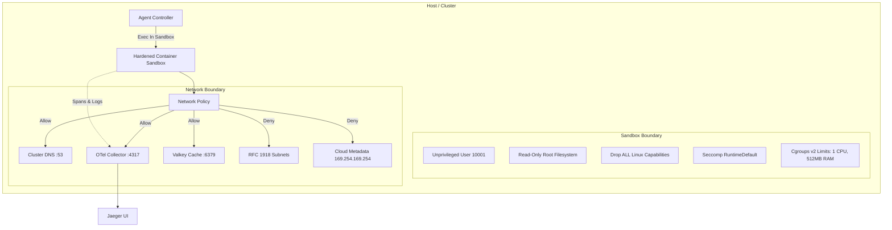

# Pattern: Zero-Trust Sandboxing & Distributed Observability

> **Pattern Class**: Runtime Isolation & Distributed Observability
> **Problem**: Agents synthesize and execute untrusted code, and raw execution privileges expose the host and the network behind it
> **Solution**: Rootless, capability-dropped sandboxes paired with high-fidelity telemetry, so isolation is verifiable rather than assumed
> **TLDR**: Execute untrusted agent code in rootless, capability-dropped containers with full distributed trace telemetry and bounded resource limits.
> **ELI:7b**: Run AI-generated code in a locked-down container with no root permissions, full activity logging, and strict CPU/memory limits.
> **Reference Implementation**: [`examples/ephemeral-container-sandbox/`](../examples/ephemeral-container-sandbox/)

A defense-in-depth architectural pattern coupling isolated, unprivileged execution environments with continuous, high-fidelity distributed telemetry.

---

## 1. Problem Statement

Autonomous coding agents routinely synthesize, compile, and execute untrusted code (scripts, tests, database queries, network requests). Granting agents raw execution privileges on developer host machines or production clusters exposes systems to severe vulnerabilities:
- **Server-Side Request Forgery (SSRF)**: Inadvertent crawling or scanning of internal RFC 1918 subnets, cloud metadata APIs (`169.254.169.254`), or private databases.
- **Resource Starvation / Fork Bombs**: Runaway loops or deeply recursive subagent subprocesses exhausting CPU, memory, and process table slots.
- **Blind Execution**: Running code without real-time observability makes it impossible to distinguish between a hang, an infinite loop, or a long-running test suite.

---

## 2. Core Mechanics

The pattern combines **Container Sandboxing Invariants** with an **OpenTelemetry Telemetry Mesh**:



### Three Pillars of Isolation:

1. **Unprivileged Process Isolation**:
   - `runAsNonRoot: true` with non-zero UID/GID (`10001`). This is not the same as rootless: a rootless runtime (rootless Docker or Podman) runs the container engine itself without root. The reference implementation sets a non-root UID and is rootless only when the runtime is.
   - Root filesystem is mounted read-only (`readOnlyRootFilesystem: true`); temporary scratch space is mounted on size-bounded `tmpfs` or `emptyDir` volumes.
   - All kernel capabilities are dropped (`drop: ["ALL"]`), preventing raw network sockets and other privileged operations. A setuid-root binary can still give a process UID 0 unless `no-new-privileges` is also set (`allowPrivilegeEscalation: false` in Kubernetes).
2. **Egress Firewalling & SSRF Prevention**:
   - Outbound network traffic is filtered at the kernel/CNI layer via Kubernetes `NetworkPolicy` (enforced only by a CNI plugin that implements it) or, for Docker, host firewall rules such as the `DOCKER-USER` iptables chain. A Docker bridge network alone does not filter by destination.
   - Standard `NetworkPolicy` has no deny rules. Once a policy selects the pod, all egress is denied except what allow rules permit: pod selectors for DNS, the OTel collector and Valkey, and, only if internet egress is needed, an `ipBlock` of `0.0.0.0/0` that lists the private RFC 1918 ranges (`10.0.0.0/8`, `172.16.0.0/12`, `192.168.0.0/16`) and `169.254.169.254/32` in `except`.
   - The reference implementation does not filter by address. It runs containers with `--network none`, so the container has no network at all.
3. **Telemetry Streaming**:
   - Execution commands within the sandbox stream child spans and standard streams to the local OTel Collector over in-cluster endpoints.
   - If execution times out or triggers an egress block, an alert fires instantly with the associated trace ID.

---

## 3. Implementation Blueprint

### Docker Sandbox Definition:
```yaml
agent-sandbox:
  image: python:3.14-slim
  user: "10001:10001"
  read_only: true
  cap_drop: ["ALL"]
  security_opt: ["no-new-privileges:true"]
  pids_limit: 100
  tmpfs:
    - /tmp:size=64M,mode=1777
    - /workspace:size=256M,mode=0755
  deploy:
    resources:
      limits:
        cpus: "1.0"
        memory: 512M
```

### Trace Injection Wrapper:
```python
import subprocess

def run_in_sandbox(command: list[str], traceparent: str, timeout_seconds: int = 30) -> subprocess.CompletedProcess:
    """Execute command inside sandbox container with W3C trace context."""
    return subprocess.run(
        ["docker", "exec", "-e", f"TRACEPARENT={traceparent}", "-e", "PYTHONUNBUFFERED=1",
         "vibes-agent-sandbox", *command],
        capture_output=True,
        text=True,
        timeout=timeout_seconds,
        check=False
    )
```

---

## 4. Key Takeaways

1. **Sandboxing is Not Optional**: Never allow an autonomous LLM to execute synthesized code directly on host developer machines.
2. **Egress is the Weakest Link**: Many sandboxes secure the filesystem but leave outbound networking open. Blocking private ranges and the metadata endpoint prevents SSRF to internal targets. It does not stop exfiltration to public hosts; only an allow-list or `--network none` does that.
3. **Observability Completes the Loop**: Sandboxes without distributed tracing turn timeouts into debugging nightmares. Spans provide immediate visibility into command hangs and resource thrashing.
