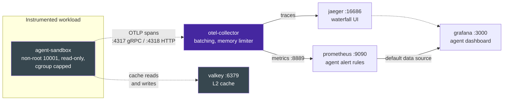

# Docker Compose: Local Agent Observability & Sandbox Environment

A multi-container local evaluation environment with distributed tracing, a metrics store, dashboards, an in-memory cache, and a hardened sandbox container. Prometheus loads the agent alert rules and Grafana loads the agent dashboard, but no code in this repository emits the metrics that they read: see [Known Gaps](#known-gaps).

---

## Service Architecture

| Service | Image | Local Port | Role |
|---|---|---|---|
| **`jaeger`** | `jaegertracing/jaeger:2.23.0` | `:16686` (UI), `:4317` (gRPC), `:4318` (HTTP) | Distributed trace collector and timeline waterfall UI (Jaeger v2). Its healthcheck fails when the UI does not answer on `:16686`. |
| **`otel-collector`** | `otel/opentelemetry-collector-contrib:0.112.0` | `:8889` (Prometheus), `:13133` (Health) | Ingestion pipeline with batching and a memory limiter. It deletes three secret-bearing HTTP header attributes from spans and inserts two attributes. |
| **`prometheus`** | `prom/prometheus:v2.55.0` | `:9090` (UI) | Metrics database. It loads the agent alert rules from [`prometheus.yaml`](../observability/prometheus.yaml) and scrapes the collector on `:8889`. |
| **`valkey`** | `valkey/valkey:8.0.1` | `:6379` | In-memory cache (`256mb`, `allkeys-lru`). No other service in the stack uses it. |
| **`grafana`** | `grafana/grafana:11.3.0` | `:3000` (UI) | Dashboards. It provisions a default Prometheus data source and the agent dashboard from [`grafana/provisioning/`](../observability/grafana/provisioning/). |
| **`agent-sandbox`** | `python:3.14.10-slim` | *Internal only* | Non-root (`10001`), read-only container with CPU and memory limits. It runs `sleep infinity`; use `docker exec` to run code in it. |

Each image has a pinned version tag. The Kubernetes manifests in [`../k8s/`](../k8s/README.md) use the same tag for each service that they also run.



Solid edges work as shipped. Dotted edges need your code or extra configuration: the sandbox sends nothing by itself, and Grafana has no Jaeger data source (see [Known Gaps](#known-gaps)).

> [!NOTE]
> The collector deletes the span attributes `http.request.header.authorization`, `http.request.header.cookie` and `http.request.header.proxy-authorization` (processor `attributes/scrub`) before it exports a span to Jaeger. It scrubs no other key. For each other attribute that can carry a secret, add an `attributes` action `delete` or `hash`, or the contrib `redaction` processor, to the traces pipeline in [`otel-collector-config.yaml`](../observability/otel-collector-config.yaml). The scrub applies only to spans that go through the collector: spans sent to host port `4318` go to Jaeger directly (see step 4).

---

## Quickstart

### 1. Initialize Environment
```bash
cp .env.example .env
```

Set `GF_SECURITY_ADMIN_PASSWORD` in `.env`. The stack does not start without it.

### 2. Start the Stack
```bash
docker compose up -d
```

### 3. Verify Health & Service Endpoints
- **Jaeger Tracing Waterfall**: [http://localhost:16686](http://localhost:16686)
- **Prometheus Metrics & Alerts**: [http://localhost:9090](http://localhost:9090)
- **Grafana Dashboards**: [http://localhost:3000](http://localhost:3000) (user `admin`; password from `GF_SECURITY_ADMIN_PASSWORD` in your `.env`, which has no default)
- **Valkey L2 Cache**: `valkey-cli -p 6379 ping` -> `PONG`

Prometheus shows the `agent_operational_alerts` group on its **Alerts** page. Grafana lists the `Vibes — AI Agent Observability & Quality Mesh` dashboard, and its Prometheus data source is the default.

To check the configuration without a running stack:
```bash
docker compose config --quiet
docker compose run --rm --no-deps --entrypoint promtool prometheus check config /etc/prometheus/prometheus.yml
```
`promtool` reports `SUCCESS: 1 rule files found` and `SUCCESS: 5 rules found`.

### 4. Pipe Agent Waterfall Traces into Live Jaeger
You can pipe spans directly from the `agent-telemetry-trace-generator` reference app. Host port `4318` is published by the `jaeger` service, not by `otel-collector`, so these spans go straight to Jaeger and skip the collector:
```bash
# In another terminal, send the generator's spans to Jaeger's OTLP/HTTP port
python3 ../../examples/agent-telemetry-trace-generator/generator.py --export-otlp http://localhost:4318/v1/traces
```

### 5. Teardown
```bash
docker compose down
```

---

## Known Gaps

- **No code in this repository emits the `vibes_agent_*` metrics** that the alert rules and the dashboard read. The rules load but stay inactive, and the dashboard panels show no data, until your agent sends matching OTLP metrics to the collector. The collector exporter adds the `vibes_agent_` prefix to each metric name.
- **Grafana has no Jaeger data source.** To show traces in Grafana, add a Jaeger data source at `http://jaeger:16686`.
