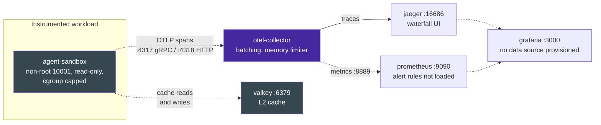

# Docker Compose: Local Agent Observability & Sandbox Environment

A multi-container local evaluation environment with distributed tracing, a metrics store, dashboards, an in-memory cache, and a hardened sandbox container. Some services are not connected to each other by default: see [Known Gaps](#known-gaps).

---

## Service Architecture

| Service | Image | Local Port | Role |
|---|---|---|---|
| **`jaeger`** | `jaegertracing/all-in-one:1.62.0` | `:16686` (UI), `:4317` (gRPC), `:4318` (HTTP) | Distributed trace collector and timeline waterfall UI. |
| **`otel-collector`** | `otel/opentelemetry-collector-contrib:0.112.0` | `:8889` (Prometheus), `:13133` (Health) | Ingestion pipeline with batching and a memory limiter. It inserts two attributes and scrubs nothing. |
| **`prometheus`** | `prom/prometheus:v2.55.0` | `:9090` (UI) | Metrics database. The agent alert rules file is mounted but not loaded. |
| **`valkey`** | `valkey/valkey:8.0.1` | `:6379` | In-memory cache (`256mb`, `allkeys-lru`). No other service in the stack uses it. |
| **`grafana`** | `grafana/grafana:11.3.0` | `:3000` (UI) | Dashboards. The agent dashboard JSON is mounted but not provisioned. |
| **`agent-sandbox`** | `python:3.14-slim` | *Internal only* | Non-root (`10001`), read-only container with CPU and memory limits. It runs `sleep infinity`; use `docker exec` to run code in it. |



Solid edges work as shipped. Dotted edges need your code or extra configuration: the sandbox sends nothing by itself, and see [Known Gaps](#known-gaps) for the rest.

> [!NOTE]
> The collector does not scrub span attributes. Its `attributes/agent_defaults` processor only inserts `environment` and `agent.telemetry.mesh`. To redact once, centrally, before storage, add the contrib `redaction` processor or `attributes` actions `delete` or `hash` to the traces pipeline in [`otel-collector-config.yaml`](../observability/otel-collector-config.yaml).

---

## Quickstart

### 1. Initialize Environment
```bash
cp .env.example .env
```

### 2. Start the Stack
```bash
docker compose up -d
```

### 3. Verify Health & Service Endpoints
- **Jaeger Tracing Waterfall**: [http://localhost:16686](http://localhost:16686)
- **Prometheus Metrics & Alerts**: [http://localhost:9090](http://localhost:9090)
- **Grafana Dashboards**: [http://localhost:3000](http://localhost:3000) (user `admin`; password from `GF_SECURITY_ADMIN_PASSWORD` in your `.env`, which has no default)
- **Valkey L2 Cache**: `valkey-cli -p 6379 ping` -> `PONG`

### 4. Pipe Agent Waterfall Traces into Live Jaeger
You can pipe spans directly from the `agent-telemetry-trace-generator` reference app. Host port `4318` is published by the `jaeger` service, not by `otel-collector`, so these spans go straight to Jaeger and skip the collector:
```bash
# In another terminal, send the generator's spans to Jaeger's OTLP/HTTP port
python3 ../../examples/agent-telemetry-trace-generator/generator.py --export-otlp http://localhost:4318/v1/traces
```

### 5. Teardown
```bash
docker compose down
```

---

## Known Gaps

- **Prometheus loads no agent rules and does not scrape the collector.** The service starts with the default `prometheus.yml` of the image, which scrapes only `localhost:9090` and has no active `rule_files`. `prometheus-agent-alerts.yaml` is mounted at `/etc/prometheus/alerts.yaml` but is not loaded. To connect them, mount a `prometheus.yml` that lists `rule_files: [/etc/prometheus/alerts.yaml]` and a scrape job for `otel-collector:8889`.
- **Grafana does not load the dashboard.** Grafana reads dashboard files only through a provider in `/etc/grafana/provisioning/dashboards/`, and the stack provisions no provider and no data source. Add a Prometheus data source at `http://prometheus:9090`, then import `agent-telemetry-dashboard.json` by hand.
- **No code in this repository emits the `vibes_agent_*` metrics** that the alert rules and the dashboard read.
- **The `jaeger` healthcheck always passes**, because its command ends with `|| exit 0`.
