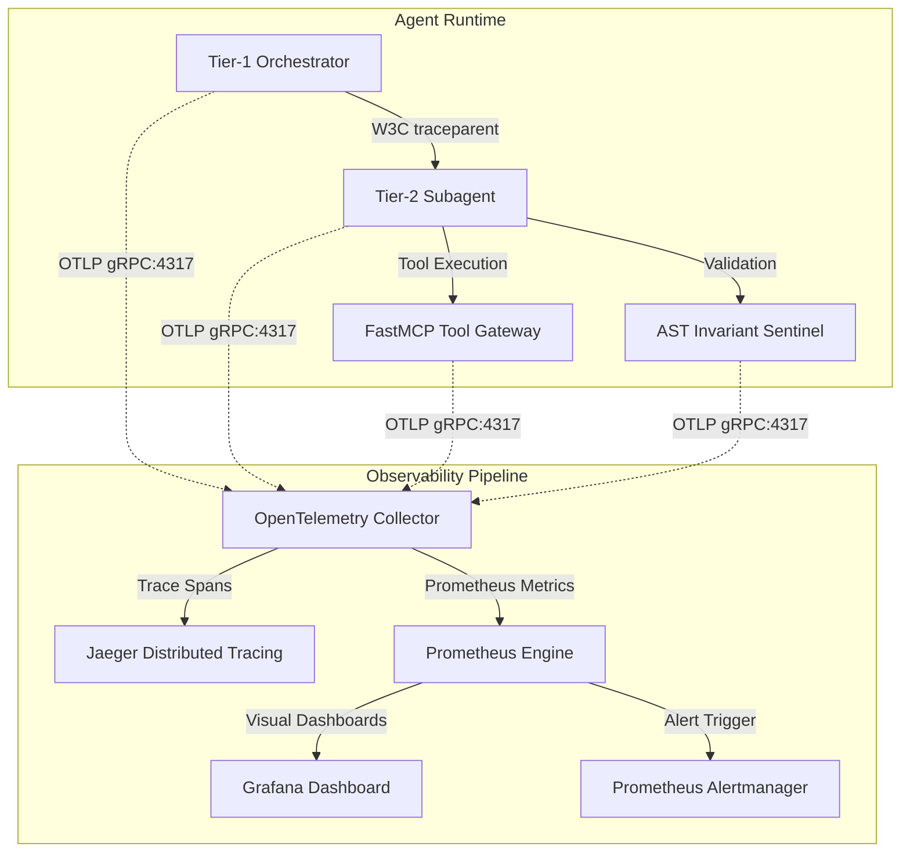

# Agentic Observability & Telemetry Mesh

OpenTelemetry, Prometheus, and Grafana configurations engineered specifically for multi-turn AI coding agents, subagent hierarchies, and architectural quality gates.

---

## Architecture Overview

Traditional application monitoring focuses on HTTP request rates and database query latencies. AI coding agents introduce non-deterministic, multi-scale failure modes that require a specialized telemetry mesh:



The diagram shows the target design. This directory ships the collector config, the Prometheus config, the alert rules, the dashboard and its Grafana provisioning files. It ships no Alertmanager. In the Compose stack, Prometheus scrapes the collector and loads the alert rules, and Grafana loads the dashboard (see [Known Gaps](../docker-compose/README.md#known-gaps) for what is not connected).

---

## Semantic Attribute Conventions for GenAI Agents

All agent traces should emit standardized semantic attributes compliant with the evolving OpenTelemetry GenAI standards and `vibes` extensions:

| Attribute Key | Type | Description | Example |
|---|---|---|---|
| `gen_ai.provider.name` | `string` | The underlying inference provider | `anthropic`, `ollama`, `openai` |
| `gen_ai.request.model` | `string` | Target model identifier | `claude-3-7-sonnet-latest`, `qwen2.5-coder:32b` |
| `gen_ai.usage.input_tokens` | `int` | Inbound context tokens | `4820` |
| `gen_ai.usage.output_tokens` | `int` | Output generated tokens | `640` |
| `agent.persona` | `string` | Operational role for this execution step | `architect`, `coder`, `sentinel`, `reviewer` |
| `agent.slot_id` | `string` | Unique identifier of active worker slot | `subagent-worker-02` |
| `agent.invariant.checked` | `boolean` | Whether AST complexity gates were evaluated | `true` |
| `agent.invariant.status` | `string` | Quality gate result | `passed`, `violation` |
| `agent.cegis.round` | `int` | Counterexample synthesis iteration index | `3` |

---

## Included Resources

1. [**`otel-collector-config.yaml`**](./otel-collector-config.yaml):
   - Ingests OTLP spans and metrics over gRPC (`4317`) and HTTP (`4318`).
   - Memory limiter protection (`75%` limit with `20%` spike buffer).
   - Deletes the span attributes `http.request.header.authorization`, `http.request.header.cookie` and `http.request.header.proxy-authorization` (processor `attributes/scrub`), then inserts two default attributes (`environment`, `agent.telemetry.mesh`). It scrubs no other key: for each other attribute that can carry a secret, add an `attributes` action `delete` or `hash`, or the contrib `redaction` processor. The Kubernetes ConfigMap in [`../k8s/observability/otel-collector-deployment.yaml`](../k8s/observability/otel-collector-deployment.yaml) has its own copy of the traces pipeline with the same `attributes/scrub` processor.
   - Dual export to Jaeger (`jaeger:4317`) and Prometheus (`:8889`).

2. [**`prometheus.yaml`**](./prometheus.yaml):
   - Prometheus configuration for the Compose stack. It lists the alert rules in `rule_files` and scrapes the collector at `otel-collector:8889`.
   - The `rule_files` path is the path in the container, so run `promtool check config` in the container (see the [Docker Compose README](../docker-compose/README.md#3-verify-health--service-endpoints)).

3. [**`prometheus-agent-alerts.yaml`**](./prometheus-agent-alerts.yaml):
   - `AgentTokenBurnSpike`: Triggers when token velocity exceeds 50k tokens/min.
   - `AgentASTInvariantBreachRate`: Alerts when >25% of synthesis attempts fail complexity caps.
   - `AgentCEGISConvergenceStall`: Alerts if counterexample search exceeds 8 rounds.
   - `AgentAPIQuotaNearExhaustion`: Warns when client-side token bucket falls below 100 requests.
   - `AgentEgressViolationAttempt`: Pages when `vibes_agent_egress_firewall_blocks_total` increases. A Kubernetes NetworkPolicy exports no such metric, so your egress filter must emit it.
   - No code in this repository emits the `vibes_agent_*` metrics that these rules read; only this file and the dashboard name them.

4. [**`grafana/agent-telemetry-dashboard.json`**](./grafana/agent-telemetry-dashboard.json):
   - Grafana dashboard with 5 panels: token spend velocity, P50/P90/P99 tool execution latencies, AST gate pass/fail ratio, CEGIS round counts, and Valkey L2 cache hit ratio. The panels name no data source, so Grafana uses its default one.

5. [**`grafana/provisioning/`**](./grafana/provisioning/):
   - `dashboards/agent.yaml`: a file provider that loads the dashboard JSON from `/var/lib/grafana/dashboards`.
   - `datasources/prometheus.yaml`: the default Prometheus data source at `http://prometheus:9090`.
   - The Compose stack mounts both directories under `/etc/grafana/provisioning/`.

---

## Quickstart (Local Evaluation)

Launch the full observability mesh via Docker Compose:

```bash
cd resources/docker-compose
cp .env.example .env   # then set GF_SECURITY_ADMIN_PASSWORD
docker compose up -d
```

- Jaeger UI: [http://localhost:16686](http://localhost:16686)
- Prometheus Engine: [http://localhost:9090](http://localhost:9090)
- Grafana Dashboard: [http://localhost:3000](http://localhost:3000) (user `admin`; password from `GF_SECURITY_ADMIN_PASSWORD` in your `.env`, which has no default)
